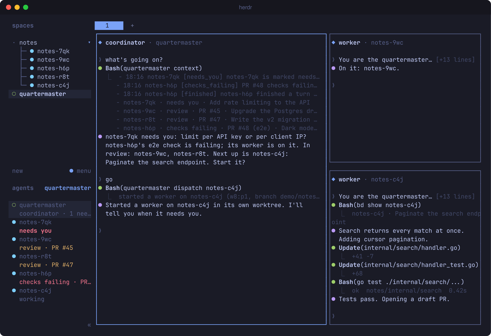
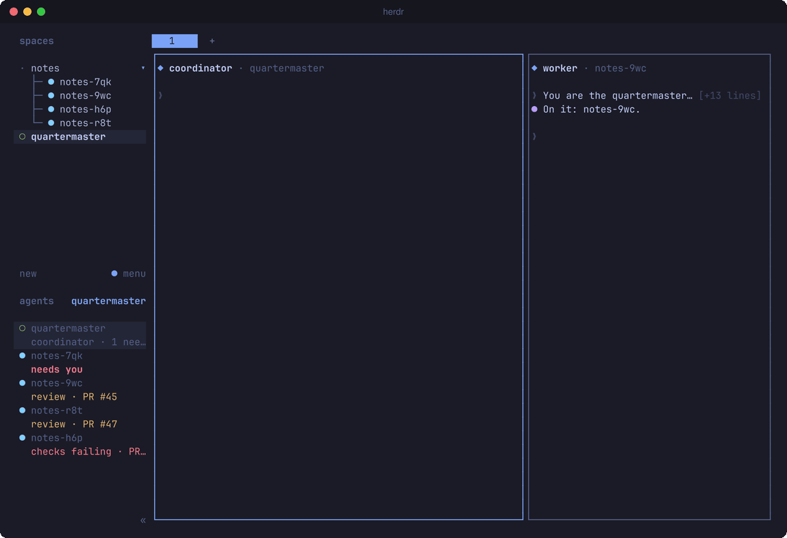
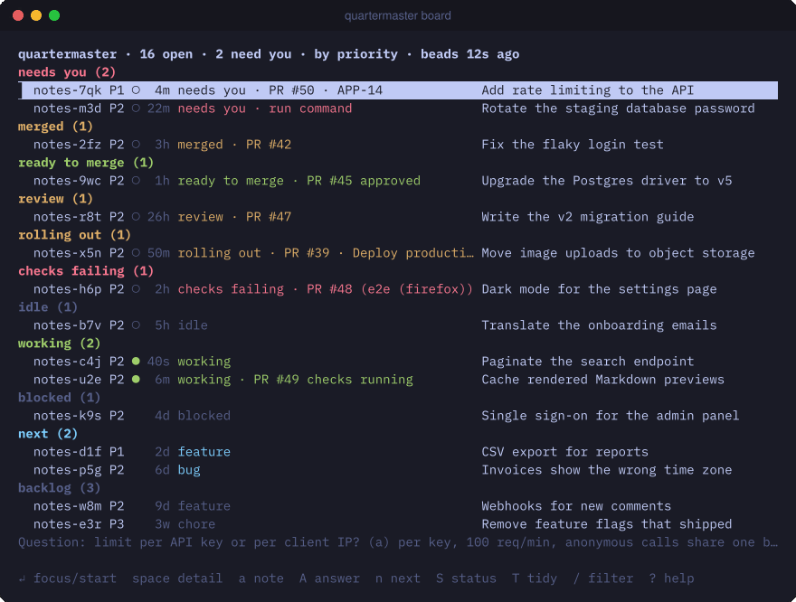

# quartermaster

Run many coding agents in parallel from one conversation.

You talk to one coordinator. It turns what you want into
[beads](https://github.com/steveyegge/beads), starts a worker for each one in
its own git worktree, and keeps checking on them for you, so you're only pulled
in when someone needs a decision. It's a [Herdr](https://herdr.dev) plugin: the
workers are ordinary Claude Code, Codex or Muse Code sessions in Herdr panes, and their
state shows in Herdr's sidebar.



<sub>The coordinator in a Herdr workspace, with two workers' screens beside it
and every thread's state in the sidebar. Made-up demo data and stand-in
agents; [the board](docs/images/board.png), [a thread's
detail](docs/images/board-detail.png) and [the tidy
view](docs/images/board-tidy.png) look like this.</sub>

## Why

- **One place to coordinate from.** A single coordinator session plans, splits
  work into beads, dispatches workers and relays their questions. It never
  does the work itself, so it's always free to answer you.
- **Workers get checked on automatically.** A background ticker follows every
  thread on a schedule: it tells a worker when its PR's checks fail, when review
  feedback lands and when it merges, and nudges the coordinator when there's
  news. You don't poll agents; the ones that need you rise to the top of the
  sidebar.
- **Worktrees and workers are handled for you.** One bead gets one branch, one
  worktree and one agent named after the bead. Starting a thread is one key;
  cleaning up after a merge is one command.
- **Beads is the only state.** No task file or database of quartermaster's own:
  statuses, notes and memories live in `bd`, which many agents can update at
  once. That's what lets you run many threads without them stepping on each
  other, and what lets any session, including the coordinator after a restart,
  pick up exactly where things are.

## See it work



<sub>30 seconds, also as [MP4](docs/images/quartermaster-demo.mp4): you ask
the coordinator what's going on, it reads `quartermaster context` and proposes
a bead, you say go and it dispatches a worker; the board filters to what's in
review; then a PR is approved, the ticker flips its thread to ready to merge
and nudges the coordinator, which tells you. Recorded in a scratch Herdr
session on made-up data. The agents are stand-ins that answer from a script
(no model runs) and `gh` answers from a file; quartermaster, Herdr and bd are
real. Waits for an agent to start and for the ticker's next GitHub pass are
cut. `scripts/demo/record.sh` records it again.</sub>

## How it works

### The pieces

| Piece | What it is | What it owns |
|---|---|---|
| **Beads** (`bd`) | The issue tracker in your repo | All task state: status, notes, questions, lessons. The only record. |
| **Herdr** | The terminal the agents run in | Panes, agent names and states, worktrees, the sidebar, notifications |
| **Coordinator** | One agent named `quartermaster`, in `~/.local/state/quartermaster/coordinator` | Talking to you, planning, creating beads, dispatching. Never does the work. |
| **Workers** | One agent per bead, named after the bead, in the bead's worktree | Doing the work and keeping their bead current |
| **Ticker** | A background loop (`quartermaster ticker`), started with the plugin | Watching threads, following PRs and runs, prompting workers, the inbox, the sidebar |

An opt-in [headless pi coordinator](docs/pi-headless.md) handles explicitly
enrolled native workers' post-merge follow-through independently of the editor,
with fenced ownership, durable outcome reconciliation and a local report outbox.
It does not change the default Herdr/TUI mode or migrate existing workers.

The coordinator and the ticker never talk to each other directly. The ticker
writes events to an **inbox** (files in `~/.local/state/quartermaster/inbox/`) and
nudges the coordinator; the coordinator reads the inbox through
`quartermaster context`. Everything a worker wants to say goes into its bead.

### The loop

```
  you ──── talk ────▶ coordinator ── quartermaster dispatch ──▶ worker (own worktree)
   ▲                    ▲     │                                  │  ▲
   │                    │     └── quartermaster context◀┐           │  │ prompts, once idle 60s
   │ notifications      │ nudge                      │ inbox     │  │ (checks, reviews, merge, runs)
   │ + sidebar          │                            │           ▼  │
   └──────────────────── ticker ─────────────────────┴──── reads bd and herdr every 15s,
                                                            GitHub PRs and runs every 60s
```

1. **You ask the coordinator for something.** It runs `quartermaster context`,
   creates beads for the work (`bd create`, with parents and dependencies), and
   proposes threads. It waits for your go-ahead.
2. **The coordinator dispatches.** `quartermaster dispatch <bead>` claims the bead,
   creates a worktree on `<branch_prefix><bead>-<slug>`, starts Claude, Codex or
   Muse named after the bead, and sends the **brief**: the bead id and title, the
   worktree and branch, the Linear key if there is one, how to report, and
   your `instructions.md`. If the agent opens on a startup prompt (folder
   trust), the brief goes to the **outbox** and you're notified; the ticker
   delivers it once the agent is ready.
3. **The worker works and writes to its bead.** Findings and decisions go in
   `bd note`. It notes `PR: <url>` when it opens a PR and any Actions run URL
   it's waiting on. Where GitHub requires an approving review on the base
   branch, it turns on auto-merge (`gh pr merge <url> --auto --squash`) once
   the PR isn't a draft and its merge check passes; on a base branch that
   requires no approving review, native `--auto` is refused because it can
   merge immediately without approval. Direct merges and `ready_to_merge`
   require task authorization, ownership, an independent write-capable
   reviewer's approval of the exact head within 7 days, complete review and
   thread evidence, all threads resolved (even outdated ones), and GitHub's
   required reviews/checks satisfied with no checks pending. A repository with
   no required review is not consent to merge; unsupported operations and
   `--admin` never fall back to a bypass. A PR that needs a human decision
   keeps auto-merge off. When it needs a decision, it writes the question and sets
   the bead to `needs_me`. When it needs you to run a command, it writes
   `RUN: <command>` and sets `needs_me`. After a merge with steps left, it adds
   the `rolling-out` label.
4. **The ticker watches.** Every 15 seconds it reads the active beads
   (`in_progress`, `needs_me`, `blocked`) and Herdr's agents, and joins them by
   name. Every 60 seconds it also asks GitHub about each bead's PR (found by
   branch, or by a PR link in the notes) and any Actions runs linked in the
   notes. It compares each thread with what it saw last time.
5. **The ticker acts on what changed:**
   - **The sidebar:** each worker's row gets its state line, like
     `review · PR #411 approved · ENG-1024`, and the agent view sorts what
     needs you to the top.
   - **The worker:** failing checks, new review feedback, a PR ready to merge,
     auto-merge turned off, a merge or a finished run become a prompt to that
     worker. GitHub turns auto-merge off when the base branch changes or
     someone without write access pushes; while the PR is open, not a draft,
     not waiting on you and its base branch requires an approving review, the
     worker is asked to turn it back on unless it disabled it intentionally. Prompts wait until the worker has
     been idle for `idle_seconds`, so they never land in the middle of
     something, and several are sent together.
   - **The inbox:** each change is also an event file for the coordinator.
   - **You:** entering needs-you, a PR ready to merge, a merge, a failed run
     or a human review notifies you.
   - **The coordinator:** when there are new events and the coordinator has
     been idle for `idle_seconds`, the ticker nudges it to run
     `quartermaster context`.
6. **The coordinator catches up.** It reads the inbox and threads, relays
   questions and `RUN:` commands to you, passes your answers to the worker
   (`herdr agent prompt`), and marks the items handled with
   `quartermaster inbox done`.
7. **The thread finishes.** After the merge the worker verifies and closes its
   bead with a reason. The ticker sees it leave the active set and writes a
   `closed` event, and the coordinator runs `quartermaster resolve` to remove the
   worktree.

### Finishing a thread

Usually there's nothing to do. When a worker's PR merges, the ticker tells it
to verify and close its bead (`quartermaster close <id> --by worker --reason
"<what shipped and how it was verified>"`). A `rolling-out` bead is finished
first, then closed; a bead with steps after its merge or with no PR passes the
[verifier](#acceptance-criteria-and-the-verifier) before it closes. The
ticker sees the bead close and writes a `closed` event, and the coordinator
runs `quartermaster resolve <bead>`: that removes the bead's worktree and its
workspace, closing the worker's pane, and deletes the local branch if the PR
merged. At autonomy level 3 or above the ticker resolves on its own once the PR
has merged, the bead is closed and the agent is idle.

Other cases:

| Situation | What happens |
|---|---|
| Done without a PR (an investigation, an ops task) | The worker closes its bead with `quartermaster close`, which runs the verifier first; the coordinator runs `quartermaster resolve <id>` (auto-resolve only covers merged PRs) |
| Dropping or parking the work | Tell the coordinator; it closes the bead (`--reason "dropped: …"`) or defers it, then resolves it, with `--force` only if nothing in the worktree is worth keeping |
| Done, but you want the worktree a while longer | Ask the coordinator to hold off on `resolve` |
| Finished worktrees have piled up | `quartermaster sweep`, then `quartermaster sweep --yes` to remove the safe ones |
| Claims nobody is going to finish | `quartermaster stale`, then `quartermaster stale --release` to reopen them |

`resolve` refuses while the bead is still open or its agent is working, unless
you pass `--force`, and it only ever removes a linked worktree on that bead's
branch, never the main checkout. If the worker ran somewhere other than its
own worktree, there's nothing to remove; close its pane.

### Acceptance criteria and the verifier

A PR gets an independent check before it counts: review and required checks.
Two kinds of bead have no such check, so the worker that did the work would
also be the one saying it is done: one with steps after its merge (a rollout,
a deploy, a provision) and one with no PR at all (an audit, a design, an
investigation). For those, quartermaster separates the builder from the
evaluator.

**Criteria at creation.** The coordinator ends every bead description it
writes with 2-4 checkable acceptance criteria, a bullet list under a
`## Acceptance` heading: what a reader could confirm from live evidence once
the work is done. Workers do the same for beads they create for discovered
work.

**Close through quartermaster.** Workers and the coordinator close beads with
`quartermaster close <bead> --reason "..." [--by worker|coordinator|TJ]`,
never `bd close`. It runs the dial's check for closing (class 3), then sorts
the bead:

| Bead | What close does |
|---|---|
| Its notes link a PR, and nothing follows the merge | Closes it, as `bd close` always has. No verifier. |
| Labelled `rolling-out`, or Actions runs noted, or no PR noted | Runs the verifier first; closes only on a pass, removing `rolling-out`. |
| Closed `--by TJ` (or from the board) | Closes it: you are the evaluator. An in-scope bead gets a `VERIFY: skipped [TJ]` note. |

**The verifier** is a separate headless agent quartermaster starts in the
bead's repository, with a fresh context: the bead's title, description and
criteria, and pointers to evidence (its PR and Actions run URLs, `RAN:` results
you reported). It never sees the worker's notes or close reason, which are the
claim it is checking. It is read-only by construction: the default `[verifier]
command` is `claude -p` with no settings files or MCP servers, a read-only tool
set (`Read`, `Grep`, `Glob`, `WebFetch` and an allowlist of read-only commands
such as `gh pr view`, `gh run view`, `git log`, `bd show`, `kubectl get`) and
`--permission-mode dontAsk`, which denies anything else instead of stopping at
a prompt nobody is watching. It checks each criterion and ends with a verdict;
quartermaster notes it on the bead (`VERIFY: pass|fail [verifier] ✓/✗ <criterion>
— <evidence>; ...`) and appends it to `journal.jsonl`. Close trusts the
journal, not the note, since a note is one `bd note` away for the worker being
checked; a pass in the last hour lets a retried close skip a second run.

For a pi-only installation, explicitly select `[verifier] backend = "pi"`.
This opt-in backend starts a fresh, non-persistent pi JSON-mode process with
only `read`, `grep`, `find` and `ls`. Shell, generated-code tools, MCP, all
extensions (including quartermaster's worker extension), skills, prompt
and context discovery are disabled. It supports **filesystem evidence only**;
criteria requiring remote APIs or commands fail as uncheckable, rather than
silently enabling more tools. No fallback to Claude occurs. See the
[pi verifier boundary, trials and activation steps](docs/pi-verifier.md).

For beads that verify live cloud state, deployments, HTTP endpoints, or
observability queries, you can explicitly opt into `[verifier] mode =
"live-readonly"` (with `backend = "claude"` or `backend = "agy"`). Defaults
stay strict unless opted in; `live-readonly` enables only validated read-only
CLI prefixes/patterns, `GET`/`HEAD`-only HTTP checks, explicit URL domains, and
explicit read-only MCP tools while failing closed on writes, mutations, and
credential/secret reads, and labels verifier policy blocks separately from
live-evidence failures. See [docs/verifier.md](docs/verifier.md).

- **Pass:** the bead closes as usual.
- **Fail:** nothing closes. The failing criteria and their evidence print for
  whoever ran close (the worker, or the coordinator, which passes them on) and
  go in a note; the worker fixes them and runs close again.
- **Bounded:** `max_rounds` fails in a row (default 2; a pass resets the
  count) set the bead to `needs_me` with both sides' evidence, the verifier's
  findings and the worker's close reason, and a `CLASS: 3` line. You decide:
  `quartermaster close <bead> --by TJ --reason "..."`, or send the worker back.
- **No `## Acceptance` section** (beads from before this): the verifier
  derives 2-4 criteria from the description, checks those, and its note says
  the criteria were derived. It doesn't block.
- A verifier that fails to run (not installed, timed out) spends no round and
  closes nothing; close reports the error.

Two closes stay outside it: the ticker's own auto-close of stale beads
(`verify`), which acts only on strong evidence it gathered itself, and your
closes from the board. Like the dial, this is enforced in quartermaster's own
commands; a worker can still run `bd close`, which its brief forbids.

Workers save what the next worker should know with `bd remember` and move
their Linear issues as they go, and the coordinator marks inbox items handled.
If you close a bead by hand, without the coordinator, do these yourself:

- save anything the next worker should know with `bd remember "…"`; every new
  session loads it at start-up;
- mark its inbox items handled (`quartermaster inbox done <bead>`);
- move its Linear issue to Done (`quartermaster context` lists the moves due).

### Messages

Every automated message says it isn't from you, and none approves anything.

| From → to | When | Starts with |
|---|---|---|
| dispatch → worker | Once, at start | `You are the quartermaster worker for bead …` |
| ticker → worker | Checks fail, review feedback, ready to merge, auto-merge turned off, merge, run finished | `[quartermaster: automated, not the user] PR #N …`, or `… <workflow> run <url> …` for a run |
| resume → worker | After `quartermaster resume` | `[quartermaster] You were resumed after your agent exited.` |
| ticker → coordinator | New inbox items and the coordinator is idle | `[quartermaster ticker: automated, not the user, approves nothing] N new inbox item(s).` |
| worker → everyone | Any time | A note on its bead (`bd note`), or a status change |
| coordinator → worker | Relaying your answer | Whatever it writes with `herdr agent prompt` |

Inbox event kinds: `needs_you`, `checks_failing`, `new_review`,
`ready_for_review` (open, non-draft PR whose reported checks are passing with
zero failing and zero pending, mergeable/not conflicting, `REVIEW_REQUIRED`,
and zero unresolved review threads from fresh current-head gate evidence;
emitted once per head commit), `review_bump` (at most one follow-up reminder
per head commit when the exact same PR head stays green and `REVIEW_REQUIRED`
past `review_bump_hours` with no new human review),
`ready_to_merge` (task-associated, authorized by the advisory dial and owned
by the authenticated user, merge state CLEAN, HAS_HOOKS or UNSTABLE, no checks
running, no unresolved review thread including outdated threads, complete
review/thread evidence, and an independent approval of the head within 7 days;
once per head commit). GitHub requirements, task permission and head evidence
are separate: an empty review decision satisfies only GitHub's review rule.
Missing/failed/partial queries never reuse cached clearance. Successful
observations persist between ordinary ticks, for at most two GitHub refresh
intervals; the executor always fetches its own evidence before mutation. More than 100
reviews or threads blocks readiness rather than assuming the unseen page is
clear. An unavailable/deleted reviewer also blocks with an explicit reason;
unknown identity is never counted as an independent approval or discarded as
an irrelevant change request. Otherwise the board shows blockers such as
`approved but blocked: 3 open threads, missing or stale current-head approval`, `merged`,
`auto_merge_off` (GitHub turned off a PR's auto-merge on a review-required base branch), `unsafe_auto_merge`
(native auto-merge was newly enabled on a base branch requiring no approving review for an ineligible head; prompts to disable it, never fires on first sight or already-armed PRs, and clears automatically once disarmed or superseded), `run_succeeded`,
`run_failed`, `finished` (a worker finished a turn),
`agent_gone` (its agent exited), `resumed` (its agent was restarted),
`likely_stale`, `auto_closed` (from the stale-bead check or orphan finisher sweep), `orphan_finish` (an agentless merged or completed `rolling-out` bead needing verification or coordinator action), `unblocked` (a blocking dependency bead closed or a referenced upstream/watched PR merged), and `closed`.

### Features in detail

Every view uses one [derived thread state](docs/thread-state.md): the same
waiting, delivery, merged/rolling-out, working, idle, blocked and no-agent
precedence, with one PR selector. View state never authorizes a merge or a
lifecycle action.

- **Names.** Quartermaster ties a worker to its bead by name: the bead id with
  dots as dashes (`backend-ab12.3` → `backend-ab12-3`). Dispatch and resume
  set it. If something else renames a worker, the ticker renames it back once
  a minute, when it's the only agent in an active bead's worktree.
- **Needs you.** A thread needs you when its bead is `needs_me` (the question
  is extracted from its latest unanswered `CRITICAL:` / `QUESTION:` / `RUN:` /
  `OPTIONS:` note, ignoring trailing housekeeping notes such as `AUTO:`
  handoffs or `likely_stale rejected`) or its agent is stopped at a permission
  or question prompt. `quartermaster context`, `quartermaster digest`, and the
  Web Inbox (`/inbox`) split `needs_me` threads into **Active** (live unparked
  agent, active approval prompt, updated within `needs_me_parked_days` default
  7d, or unsnoozed `CRITICAL:`) vs **Parked / Dormant** (no live agent and
  older than `needs_me_parked_days`, or explicitly snoozed via
  `quartermaster snooze <bead> <duration>`), showing active threads first with
  a parked summary count. Snoozes expire automatically after their duration or
  earlier when fresh activity arrives on the bead (and can be removed anytime
  with `quartermaster snooze <bead> --clear`). Answer a thread in its pane and
  it drops out of needs you as soon as the agent is working again
  (`working · needs_me`). On its next pass the ticker sets the bead back to
  `in_progress` with the note `auto: agent resumed after needs_me`, which keeps
  the question in the history. The ticker holds its own prompts to a `needs_me`
  thread until then, so they never count as your answer.
- **Approval prompts.** For a worker stopped at a permission prompt, the
  ticker reads the prompt off its screen. The inbox item is debounced: the
  same prompt (identified by its hash; an unparsable prompt by its blocked
  episode) must keep showing for `prompt_debounce_seconds` (default 90; 0
  turns the debounce off) before the item is written and the coordinator is
  nudged, so a prompt a judge clears in seconds never wakes anyone. A
  different prompt on the same worker starts a fresh window; brief detection
  flaps — up to two ticks, 30 seconds at the default tick — keep the original
  clock, and a pending prompt is kept in the ticker's state across a restart,
  so it still surfaces exactly once, at expiry. `needs_me` questions are
  never debounced, and the sidebar, the board and `quartermaster prompt`
  still show the prompt as soon as it appears. The inbox item has its title, the
  command or file, the options, any auto-deny countdown, and a short hash of
  the prompt text: `backend-ab12 is at an approval prompt [bff9292a]: Bash
  command: … (1 Yes · 2 … · 3 No)`. A new prompt on the same worker is a new
  item. `quartermaster prompt <bead>` reads it again. `quartermaster answer
  <bead> <choice> --expect <hash>` answers it, but first reads the screen
  again and refuses if the prompt there has a different hash, so an answer
  never lands on a prompt that replaced the one it was meant for. It sends the
  option's digit (or moves the cursor and presses enter in an unnumbered
  menu), waits for the prompt to clear, and notes `PROMPT ANSWERED: <choice>
  to <prompt> [<hash>] by <coordinator|TJ>` on the bead. The coordinator
  answers on its own only for the categories its `coordinator_rules` allow,
  and relays the rest to you.
- **Answering from your phone.** With `[tap]` on (off by default), that inbox
  item also carries the prompt's own lines — the actual command — and one
  signed, one-time link per option, served by the ticker on this machine's
  Tailscale address only. Tapping a link from a phone named in `[tap] devices`
  opens the prompt, re-read live, with one button for that option; pressing it
  answers through the same `--expect` hash check as `answer --by TJ`, and the
  note ends `by TJ via tap (device …)`. A stale, replayed or wrong-device tap
  is refused and journalled. Only prompts the parser recognizes get links —
  Muse prompts are not parsed yet. A `needs_me` question written in the
  `QUESTION:` / `OPTIONS:` / `CLASS:` convention gets the same links on its
  inbox item; tapping one notes `NEEDS_ME ANSWERED: … by TJ via tap
  (device …)`, returns the bead to `in_progress`, and prompts its worker
  with the answer. Free-text questions are unchanged. The same listener also
  serves a bookmarkable, mobile-first **Tailnet Web Inbox** at `/inbox` (and
  `/inbox.json`, with `/` redirecting to `/inbox`; `quartermaster tap url`
  prints the URL), an on-demand JSON link minter at `GET /tap-links/<bead>`
  (fresh 15-minute links per call, never persisted or logged), and a
  cursor-based notification feed at `GET /events?since=<seq>&limit=<N>&event=<kinds>`
  backed by `<state>/notify/events.json` behind the exact same fail-closed
  tailnet IP +
  `tailscale whois` `[tap] devices` allowlist, showing live approval prompts,
  `needs_me` questions (including `RUN:` commands, free-text notes, and
  optional structured review cards under `cards/<bead>/`), pending checked
  execution plans (approved via two-step confirm+POST with signed one-time
  nonces bound to digest and device), and ready-to-merge PRs. `GET` never
  mutates state. See [docs/approval-taps.md](docs/approval-taps.md).
- **Commands only you can run** (a classifier denial, an interactive login, a
  production change) come back as a `RUN: <command>` note on a `needs_me`
  bead. The sidebar shows `needs you · run command`, the coordinator relays it
  ready to paste after `!`, and `p` in the board copies it. When you've run it
  the worker notes `RAN: <command> → <result>`. A `RUN:` only counts while it's
  one of the bead's last two notes, so an answered command is never offered
  again.
- **PRs** are found by branch name or by a PR link in the bead's notes, so a
  bead worked on a differently named branch is still followed.
- **Actions runs** linked in a bead's notes (the latest three) are followed.
  The worker is told when one succeeds and to continue, and when one fails
  you're notified and the worker is told to investigate. A running workflow
  shows on the thread's state line.
- **Watches.** `quartermaster watch` attaches read-only external conditions
  (`gh-release`, `gh-pr`, `gh-run`, `http`, and opt-in `cmd`) to any non-closed
  bead. The ticker checks due watches with bounded concurrency, retires watches
  on closed or expired beads, records one-shot `watch_triggered` inbox events,
  bead notes and journal entries, and optionally wakes an idle non-`needs_me`
  worker with an automated non-approving notice. Active watches show in
  `quartermaster context`. See [docs/watches.md](docs/watches.md).
- **Async coordinator jobs.** `quartermaster job` provides a durable,
  state-dir-backed async job queue (`jobs/<id>/job.json` + fsynced `events.jsonl`)
  for the eight coordinator gate verbs (`MERGE`, `DISPATCH`, `CLOSE`, `HOLD`,
  `RESUME`, `STATUS`, `STOP`, `ANSWER`), with idempotency keys (`--key`),
  at-most-once answer claims, non-expiring `parked` waits on `needs_me`
  approvals, crash-window reconciliation in the ticker, and `qm-status` result
  retrieval without a live coordinator session or extra daemon. See
  [docs/jobs.md](docs/jobs.md).
- **`rolling-out`.** A worker adds this label when steps remain after its PR
  merges. The thread then shows **rolling out** instead of **merged**, and the
  merge prompt says to carry on rather than close.
- **Orphan finisher sweep.** Every `[orphan_finish] interval_seconds` (default
  300s), the ticker runs a bounded sweep (`max_per_pass`, default 5) over
  non-epic `open` and `in_progress` beads with no live agent and no open child
  beads that have been untouched past `grace_seconds` (default 600s). Parent
  beads with open children are never classified as `merged` or swept as orphans.
  When a bead's work ends at its own merged PR (no `rolling-out`, no noted runs,
  no remaining work noted) and its autonomy check for `close` (class 3) passes,
  the ticker closes it, removes its clean merged worktree via `resolve`, and
  emits a deduplicated `auto_closed` event. When a bead is labelled
  `rolling-out` with all noted post-merge runs completed, requires verification,
  has work remaining, is below autonomy level 3, or fails to close, the ticker
  emits a deduplicated `orphan_finish` inbox item naming the bead, PR/runs, and
  suggested `quartermaster close` or `quartermaster resume` command without
  retrying infinitely.
- **Blocker-cleared wakeup.** Across ticks, the ticker tracks `blocks`
  dependencies (`bd dep`) and upstream/waiting PR URLs referenced in a bead's
  notes or `gh-pr` watches. When a blocking bead transitions to `closed` or a
  referenced PR transitions to `MERGED`, it emits a deduplicated `unblocked`
  event. If the bead has a live idle worker (at rest, not `needs_me`, not
  held/headless/parked/relaunching) and its autonomy level reaches class 3
  (`wake`), the ticker wakes the worker once with the exact cleared blocker
  (closed bead ID or merged PR URL and commit SHA) and records an `AUTO:` note;
  otherwise it surfaces `unblocked` to the coordinator inbox. Deduplication
  state persists in `state.json` across ticker restarts.
- **Headless inbox runner (opt-in).** When `[inbox_runner] enabled = true`
  (default `false`), the ticker asynchronously launches a single-flight
  headless coordinator turn for allowlisted non-human-gated inbox items
  (`ready_for_review`, `review_bump`, `orphan_finish`, `merged`, `closed`,
  `unblocked`, `checks_failing`, `likely_stale`) once items age past
  `idle_seconds` and the interactive coordinator is idle past `idle_seconds`
  or closed — skipping safely whenever the interactive TUI is working or had
  recent input. Enforces an exclusive `flock` (`inbox-runner.lock`), cooldown,
  process-group timeout, and persisted per-file `max_attempts` cap
  (`inbox-runner.json`). Inspect or trigger with
  `quartermaster inbox-runner status [--json]` and
  `quartermaster inbox-runner run [--dry-run]`; disable anytime with
  `enabled = false`. See [docs/inbox-runner.md](docs/inbox-runner.md).
- **Outbound notification sinks and durable event feed.** Sanitized ticker
  milestones, blockers (including `class` on `needs_me` items), and headless
  inbox runner outcomes are recorded automatically into a bounded durable ring
  buffer (`<state>/notify/events.json`, mode `0600`, last 500 events with
  monotonic `seq`) — even when `[desktop] enabled = false` and no outbound sinks
  are configured — served via `GET /events?since=<seq>&limit=<N>&event=<kinds>`
  on the fail-closed tailnet tap server and inspectable locally via
  `quartermaster notify events [--since <seq>] [--limit <N>] [--event <kinds>] [--json]`.
  You can also configure opt-in `[[notify.webhooks]]` (JSON envelope or plain
  text, with `url_env` and `header_envs` so secrets stay out of `config.toml`)
  and `[[notify.commands]]` (direct argv without shell, JSON on stdin,
  process-group timeout) under `[notify]` to push notifications independently
  of `[desktop] enabled = false`. Delivery state and per-sink cooldown queues
  persist atomically in `<state>/notify/status.json` (0600) so bursts coalesce
  without dropping across restarts. Inspect or test with
  `quartermaster notify status [--json]` and
  `quartermaster notify test [--sink <name>]`. See
  [docs/notifications.md](docs/notifications.md).
- **Bot reviews** (Codex, CodeRabbit and other GitHub Apps) are told apart from
  human ones. Both go to the worker; only a human review notifies you.
- **Resume.** Herdr restarts don't relaunch agents. `quartermaster resume` restarts
  each claimed bead's agent in its worktree with `claude --continue`,
  `codex resume --last`, `muse resume --last`, `pi --session-id <bead>` (the
  bead's own pi session, by id) or `agy --continue`, as whichever agent
  claimed it. `quartermaster context`
  lists resumable threads, stale claims (in progress, no agent, worktree or
  PR, untouched 7 days) and other claims separately.
- **Several repos.** Beads labelled `repo:<name>` work in that repo from
  `repos`; everything else uses `repo`. Dispatch refuses a name that isn't
  configured.
- **Linear.** The bead's issue key comes from its title, or from a `Linear:`
  note (any note, if `linear_prefixes` is set). It goes in the brief and at
  the end of the sidebar row. `quartermaster context` lists where each issue should
  be (In Review while its PR is open, Done once merged) and flags PR titles
  missing the key.
- **Choosing the agent.** `worker_agent = "auto"` picks Codex only when both
  agents' usage readings are under 6 hours old and Codex has more left;
  otherwise Claude. It never picks Muse, pi or agy, which record no usage
  reading to compare; ask for them with `--agent muse|pi|agy` or
  `worker_agent = "muse"`, `"pi"` or `"agy"`.
- **Sweep** lists linked worktrees whose PR merged, whose bead is closed, or
  that git reports prunable. `--yes` removes only the ones that are clean,
  fully pushed, have no agent in them and whose bead isn't still active. It
  deletes a local branch only when its PR merged.
- **Stale beads.** Every `verify_minutes` (hourly) the ticker re-checks open
  beads that have no agent and haven't been touched for `stale_days` (3),
  looking for evidence their work is already done:
  1. the bead's Linear issue is Done or Canceled (through the `linear` CLI,
     so only with `LINEAR_API_KEY` or `linear auth login` in the ticker's
     environment);
  2. every PR its notes link is merged, none open;
  3. merged PRs since it was opened mention its Linear key or id, and no
     more than three beads;
  4. for a bug, the code it quotes was on the default branch when it was
     opened and none of it is now (a local `git grep`);
  5. a closed bead has the same title, or the same Linear key outside its
     own family (parent, siblings, children, the same root id).

  Strong evidence closes the bead with a reason citing it, but only at
  autonomy level 3 or above: (2) when one of the merged PRs is its own
  (noted `PR: <url>`, or from its branch); and (4) once a run it links has
  failed and a later run of that workflow passed. Neither closes a bead whose
  title is rollout-shaped or whose notes after the last PR say work remains
  ("remaining", "follow-up", "OPEN", "keep open", ...). A `rolling-out`,
  `needs_me`, `blocked` or epic bead, or one with open children, is never
  closed. Everything else becomes a `likely_stale` inbox item for the
  coordinator; a closed one, `auto_closed`.

  A rejected verdict stays rejected: a note saying "likely_stale rejected" or
  "keep open", the `stale-rejected` label, or verify's own close note on a
  reopened bead sets aside the evidence present then, and only evidence that
  appears later counts.

  Passes are incremental. Each starts with one Linear query, one GitHub
  GraphQL query (the linked PRs' state and head, and per repo whose default
  branch moved, the PRs merged since the last pass, matched against beads
  locally) and a `git fetch` per repo. A bead is rebuilt only when one of
  those inputs changed, its bead changed, or its daily full re-check is due
  (description, per-bead search, failed-run lookup). Only those extra GitHub
  calls count against `verify_max`; beads over it wait for the next pass. A
  pass is skipped while fewer than `gh_min_remaining` GraphQL points are left
  this hour, since the limit is shared with every agent. A verdict is written
  to the inbox once and again only when it changes. `quartermaster verify` shows what
  a pass would do; `quartermaster verify <bead>` checks one bead in full.
- **Reporting.** `quartermaster report` prints beads closed in the window with
  their close reasons and PRs, your PRs merged without a bead, open PRs in
  flight, and `needs_me` beads with their latest note.
- **The sidebar sort** is a Herdr agent view owned by `plugin:quartermaster`: the
  coordinator first, with a row summarising what it has to deal with
  (`coordinator · 2 need you · 1 review · 3 inbox`), then threads by state
  (needs you first), then agents that aren't on a bead. Herdr drops the view
  when the plugin is unlinked, uninstalled or disabled.

State lives in `~/.local/state/quartermaster/`: `state.json` (the ticker's memory
of each thread), `inbox/` and `inbox/done/` (events), `outbox/` (briefs
waiting for an agent), `coordinator/` (its folder), `ticker.log`, and
`digest.md` and `digest-state.json` (the last digest and what it remembers),
and `board.json` (the beads the board last loaded, for its first paint).

## A day with quartermaster

What this looks like on a real working day for someone who owns a service and
its infrastructure. Bead ids, PR numbers and names are made up.

**9:00: catching up.** You open the coordinator and ask where things stand. It
runs `quartermaster context`, which starts like this (trimmed):

```
1 needs you · 1 checks failing · 2 idle

## Inbox (unhandled; `quartermaster inbox done [bead...]` when dealt with)
- 02:14 app-8zk4 [closed] app-8zk4 closed after PR #402 merged; run `quartermaster resolve app-8zk4` to remove its worktree
- 04:40 app-c71m [checks_failing] PR #405 checks failing: integration-tests

## Threads (bead · state · agent)
- app-3fq1 · needs you · claude idle · Roll the new retry policy out to the worker fleet
  question: Staging has been clean for 12h. Roll to all regions at once, or one region first?
- app-c71m · checks failing · PR #405 (integration-tests) · claude working · Upgrade the HTTP client library
```

Overnight, #405's integration tests failed. The ticker already told that
worker, and it's fixing them, so there's nothing for you to do there. #402
merged, and its worker verified the change and closed its bead. You answer the
one question: "One region first, then the rest after an hour of clean
metrics." The coordinator passes that to the worker, which resets its bead to
`in_progress` and carries on. Then the coordinator runs
`quartermaster resolve app-8zk4`, which removes the merged thread's worktree and
branch.

**9:20: new work from yesterday's incident.** You paste your incident notes: a
DNS resolver saturated under load, requests timed out, and the existing alerts
said nothing because they watch error rates, not demand. You want an alert on
resolver request rate, the connection timeout in the API service raised to
match its retry budget, and a timeline written up for the postmortem.

The coordinator creates a parent bead with three children. It notes that the
postmortem should cite the alert's threshold, so it adds a dependency and
proposes:

> Start now: **app-q2d8** (resolver request-rate alert) and **app-q2d9**
> (API connection timeout). **app-q2da** (postmortem timeline) waits on
> app-q2d8. Claude for both? Go?

You say go. Two workspaces open, each on its own branch and worktree, and both
rows show **working**.

**10:30: the ticker does the chasing.** The alert worker opens PR #411 and
notes the link on its bead. The PR's lint check fails, and the row turns red:
**checks failing · PR #411 (lint)**. You don't touch it. Once the worker has sat
idle for a minute, the ticker sends it the failing check. It fixes the lint
error and pushes, and the row goes back to **working**, then
**review · PR #411 checks running**.

On the timeout PR a teammate asks for the new value to be configurable rather
than hard-coded. The ticker sees the new review and hands it to that worker,
which makes the change, replies on the thread and pushes. You found out from
the sidebar, not by refreshing GitHub.

**11:15: a worker needs you.** The alert worker wants to run the dry run of the
alert rules against production metrics, and its agent stops at a permission
prompt. That's **needs you** at the top of the sidebar. You press `↵` on its
row in the board, look at the command, approve it, and go back to what you
were doing.

**13:00: one-offs.** A colleague posts a bead id in chat: an intermittent test
failure that needs a look. You copy it and press your focus-clipboard key
(`quartermaster.focus-clipboard`), and a worker starts on it without going through
the coordinator. Anything with a bead can
be started from the clipboard or from the board (`prefix+j`, then `c` for
Claude, `x` for Codex or `m` for Muse).

**15:30: things land.** #411 is approved and merged. Its row shows **merged**,
and the ticker tells the worker, which checks that the rule actually loaded and
then closes `app-q2d8`. That unblocks the postmortem bead; the coordinator
mentions it in its next status and, when you say so, dispatches it with the
alert's final threshold already in the bead notes.

**17:30: wrapping up.** You ask the coordinator what's left. Two threads are in
review and one is idle waiting on a teammate. On the board you press `n` on two
ready beads to mark them `next` for tomorrow. One lesson from the day, that the
resolver needs alerts on demand as well as errors, goes into `bd remember`,
so every future worker that runs `bd prime` at start-up sees it.

Nothing about the day lived in your head or a scratch file: every thread's
state, question, PR and lesson is in beads, and the next morning starts with
the same `quartermaster context`.

## The board



The board (`prefix+j`, or `quartermaster board`) is every bead that isn't
closed, grouped by what it needs: needs you, merged, ready to merge, review,
rolling out, checks failing, idle, working, blocked, no agent, then the beads
labelled `next` and the backlog. Each row has the id, priority, the agent
(`●` working, `○` idle, `!` at an approval prompt), how long since the bead
last changed, its state with PR, checks and Linear key, and the title; the
line under the list is the selected bead's latest note. It fits 80 columns.

It opens instantly: the first paint is the beads the board last loaded
(`board.json` in the state dir) with live agents, and the title says how old
they are until bd answers. bd costs a second or more a call and calls queue
behind every worker's, so the board makes one `bd list` per refresh, in the
background: every 30 seconds and after each action. Agents refresh every two
seconds. Nothing waits on GitHub; PRs and checks are the ticker's last pass.

Moving around: `j`/`k`, `^d`/`^u` a page, `g`/`G` top and bottom, `]`/`[`
(or `tab`) the next or previous section, `:` jumps to a bead by id, `s` sorts
sections by priority, most recent or oldest activity, and `/` filters as you
type, matching id, title, status, agent, state, PR, Linear key and labels
(every word, any case); `↵` keeps the filter and `esc` clears it. `?` lists
every key.

**Native pi RPC workers:** `Enter` or `V` opens a **read-only conversation
view in the existing board pane**, including parked/stopped workers with a
saved reservation. It never starts, resumes or prompts them. `h` shows saved
history, `e` the live tool/event log, `Enter` expands output, `g` replays,
`n` reads the next page, `f` follows, and `q` returns. The native row/detail
separates execution state, run elapsed time and last activity from task/PR
state; the view reports recorded model/usage without model calls. For closed
tasks use `quartermaster rpc view <bead>`. See [limits, privacy, state evidence
and replay APIs](docs/pi-rpc.md#read-only-conversations-in-the-board).
The focus-or-start clipboard action is **not** a viewer.

Moving work forward, on the selected bead (or marked rows for bulk actions):

- `;` or `M` marks/unmarks a row on the main board; `*` toggles or clears all
  marks in the current section (`esc` clears kept filters, then marks, before
  quitting). Bulk `C` (close `--by TJ` with one reason + confirm), `n` (toggle
  `next`), `R` (resume exited workers), `d` (resolve worktrees/role dirs, never
  `--force`), and `D`/`c`/`x`/`m`/`i`/`t` (dispatch) apply to all visible marked
  rows when marks are set, without changing `space`/`v` (detail pane) or `T`
  (tidy view).
- `a` adds a note; `n` toggles `next`; `S` sets the status, `P` the priority.
- `A` opens the answer view or replies to the worker:
  - On a worker blocked at an approval prompt (`!`), `A` loads the live prompt
    (command, options, and prompt hash) and lets you pick option `1`–`9` with
    confirmation, executing through the hash-verified `--expect <hash> --by TJ`
    path (refusing if the prompt hash changed).
  - On a `needs_me` bead with a structured `QUESTION:`/`OPTIONS:` block (or an
    agentless free-text question), `A` renders the full question, class,
    recommendation, and numbered options; pressing `1`–`9` (or `t` for custom
    text) confirms, records `NEEDS_ME ANSWERED: ... by TJ via board`, returns
    the bead to `in_progress`, and prompts the worker if at rest.
  - On an idle worker without a structured question, `A` prompts for a direct
    reply with confirmation, checking again that the agent is still idle before
    sending. Native RPC views remain read-only.
- `↵` views native RPC history; for other rows it focuses the bead's agent, or
  starts one (defaulting to any `role:<name>` label on the bead; press `r` on
  the confirmation line to switch roles). `c`/`x`/`m`/`i`/`t` start Claude,
  Codex, Muse, pi or agy; `D` opens the `[roles.<name>]` role picker directly
  (`implementer`, `reviewer`, `investigator`, `rollout`, or custom roles).
- `R` resumes exited worker(s) in their worktree or role directory; press `a`
  (or `c`/`x`/`m`/`i`/`t` directly on the confirmation line) to override the
  agent kind (for example resuming an exited session onto `pi`).
- `N` creates a new top-level bead (title, optional configured `repo:<name>`
  label, optional `[roles.<name>]` role, and create vs create+dispatch); `+`
  creates a child task under the selected bead.
- `@` opens the ask-coordinator input bar, forwarding a free-form prompt to the
  running idle coordinator without leaving the board.
- `E` toggles the live Events / Inbox view over unread `inbox/` entries,
  `<state>/notify/events.json`, and recent `AUTO:` journal steps; `↵` jumps to
  the event's bead on the main board and `i` acknowledges an unread inbox file.
- `C` closes the bead(s) via `quartermaster close --by TJ` with a reason; `d`
  runs `quartermaster resolve` (never `--force`).
- `y` copies the id, `p` a pending `RUN:` command, `o` opens the PR, `l` the
  Linear issue (set `linear_workspace` unless the bead's notes link it), `b`
  shows `bd show` in `$PAGER`.

Starting, resuming, answering, creating and closing ask `y/n` first. Writes
show on the board at once and the reload after them confirms what bd has.

`space` (or `v`) opens a detail pane under the list that follows `j`/`k`:
status, priority, labels, parent, created and updated, the description; what a
needs_me bead waits on (the question and its options or the `RUN:` command, in
full) and whether `A` can answer it; the note history; every linked PR with its
merge state, review decision and checks; workflow runs; the Linear key and
where the issue should be; the agent's last screen lines; and the bead's inbox
items. `J`/`K` scroll it, `esc` closes it.

`T` opens the tidy view: what looks finished, each with its evidence. Stale
claims (in progress, untouched a week, no agent, worktree or PR), beads the
verify pass flagged as likely done or closed itself, and closed beads still
holding a worktree or an agent, with the worktree's path, branch and anything
that makes removing it unsafe (dirty, unpushed commits, an agent inside).
`space` marks items and `*` marks all; `C` closes them with a reason, `u`
releases stale claims back to open (with a note), `d` runs `quartermaster
resolve` (never `--force`; a worktree that isn't safe to remove is refused),
and `i` marks only the inbox items shown in those rows handled (not unseen
items for the same bead). Obsolete condition-keyed notices are automatically
archived in `inbox/done`, preserving coordinator acknowledgement evidence.
`quartermaster context` shows each inbox filename; `quartermaster inbox done
<file>` dismisses just that item, including global lease-expiry notices. Each action applies to the marked
items it fits, or the selected one, and confirms first.

## Getting started

Once it's installed (see below), the first ten minutes:

1. **Install and configure it** (below). `configure` points quartermaster at your
   repo. Beads should already be set up there (`bd init`) with the `needs_me`
   status added.
2. **Open the coordinator** with `prefix+shift+j`. It starts in a folder of its
   own, reads `quartermaster context` and gives you a status. The first time, Claude
   asks whether to trust that folder; say yes.
3. **Give it something small.** "Add a `--json` flag to the `export` command."
   It creates a bead, proposes one thread and waits.
4. **Say go.** A new workspace opens with a worktree on
   `<prefix><bead>-add-a-json-flag`, and an agent named after the bead starts
   and gets its brief. Its row appears in the sidebar as **working**.
5. **Leave it.** When the worker opens a PR it notes the link on the bead, and
   from then on the ticker follows it. You'll see **review · PR #N** when it's
   ready for you.

## Requirements

Herdr 0.9.1+, [`bd`](https://github.com/steveyegge/beads) with a custom
`needs_me` status (`bd config set status.custom needs_me`), `gh` logged in, and
any of Claude Code, Codex, Muse Code, pi and the Antigravity CLI (`agy`).
Linux or macOS, on amd64 or arm64. Go
is only needed to build from source.

### Muse Code workers

Herdr 0.9.1 starts and tracks Muse itself (`--kind muse`), and Muse reports
its own working, idle and blocked states to Herdr, so nothing extra is
installed for it. Two things differ from Claude and Codex:

- **Its sandbox hides what a worker needs.** Muse's default shell sandbox
  runs commands without your environment, so `bd` can't see `BEADS_DIR`, and
  `gh` comes back unauthenticated, so a sandboxed Muse worker can't keep its
  bead current or open a PR. quartermaster therefore starts Muse with
  `--disable-sandbox` and the `:auto-review` permission profile unless
  `[agents.muse] args` says otherwise, and exports `BEADS_DIR` in its pane (see
  Configuration).
- **It reads `AGENTS.md`, not `CLAUDE.md` or Claude's hooks.** It falls back to
  `CLAUDE.md` only when a project has no `AGENTS.md`, and it has hooks of its
  own, so a `bd prime` SessionStart hook set up for Claude Code doesn't run in
  it. The brief tells every worker to run `bd prime` first unless a session
  hook already loaded it, then names the bead and how to report; put anything else a
  worker must know in `AGENTS.md`. The coordinator's folder gets both files.

### pi workers and coordinator

Native headless pi workers are also opt-in: `dispatch <bead> --backend pi-rpc
--agent pi`. A persistent local supervisor owns RPC, with no Herdr pane or PTY.
See [the isolated trial, controls and rollback](docs/pi-rpc.md),
[explicit steering and offline session forks](docs/pi-rpc-operations.md), and
[explicit offline retention/cleanup](docs/pi-rpc-maintenance.md) (disabled by
default; saved sessions and receipts are preserved). Existing TUI workers and
defaults are unchanged.

[pi](https://github.com/earendil-works/pi) is opt-in (details, guards and
setup in [docs/pi.md](docs/pi.md)): `--agent pi`,
`worker_agent = "pi"` or `coordinator_agent = "pi"`. Herdr starts it
(`--kind pi`) and its pi extension reports working, idle and blocked. Without an
`[agents.pi]` table, workers run `pi --approve --model
quartermaster/worker-auto` and the coordinator `pi --approve --model
quartermaster/coordinator-auto`: quartermaster's pi virtual models (needs pi
1.6), which prefer `antigravity/gemini-4-neon-xhigh` first and fail over
through Anthropic (`claude-opus-5-5` workers, `claude-fable-5-2` coordinator)
and `openai-codex/gpt-6.2-astra` when a provider's quota headroom drops at or
below 20% (recovering at 30%) or hits rate-limit/auth failover errors — see
[quota routing](docs/pi.md#quota-routing-the-auto-models). Set `args` and
`coordinator_args` to change either; a physical `--model` opts out of routing.
A worker runs in the pi session named for its bead (`--session-id <bead>`), so
dispatch and resume reopen that conversation by id.

A local pi worker also listens on a control socket for quartermaster
(`--quartermaster-control`): prompts after the brief go there and queue
behind a running turn instead of being typed into the pane, and a guarded
command listed in `[agents.pi] ask` waits for `quartermaster answer` instead
of blocking. The list starts empty. Without the socket, everything goes
through the pane as before.

Before it starts pi, quartermaster checks the model is one pi can run (`pi
--list-models` with quartermaster's extension loaded, so the virtual models
list, then `pi auth check --provider`; neither prints a credential)
and refuses with what to do: sign in with `pi auth login anthropic`, or add a
model pi's catalog lacks. An auto model needs at least one physical model in
its chain usable. Older catalogs have `claude-opus-5-5` but not
`claude-fable-5-2`; add that to `~/.pi/agent/models.json`:

```json
{ "providers": { "anthropic": { "models": [
  { "id": "claude-fable-5-2", "name": "Claude Fable 5.2", "reasoning": true,
    "input": ["text", "image"], "contextWindow": 1000000, "maxTokens": 128000 }
] } } }
```

### Worker roles

Workers default to the `implementer` role (git worktree, branch, PR-authoring
and auto-merge workflow). Built-in non-coding presets — `reviewer`,
`investigator`, and `rollout` — run with `worktree = false` in an isolated
`<state>/roles/<bead>` directory (mode `0700`) with role-specific briefs and no
throwaway branches, and can be customized or extended under `[roles.<name>]`
with per-role `agent`, `model`, `thinking`, `args`, `exclude_tools` (merged
cleanly into `pi`'s `--exclude-tools`), `brief`, and `instructions` /
`instructions_file`. Select a role with `quartermaster dispatch <bead> --role
<name>` or a `role:<name>` bead label (persisted for `resume`, `resolve`, and
`context`), and inspect effective roles with `quartermaster roles [--json]`.
See [docs/roles.md](docs/roles.md).

Built on these roles, Quartermaster also supports the bounded **design →
implement ↔ skeptical reviewer ping-pong → PR/merge → auto-chained rollout**
delivery loop: `quartermaster review request|verdict|status` tracks reviewed
head SHAs and capped rounds (`max_rounds`, default 2) across worktree-free
`role:reviewer` passes, routes concrete blocking findings back via
`quartermaster tell`, and escalates to `needs_me` at the cap; `quartermaster
dispatch <bead> --rollout-target <target>` and `quartermaster rollout
chain|status` attach a dependent `role:rollout` bead carrying
`rollout-target:<target>` that auto-dispatches once the PR bead closes when
within the autonomy dial (Class 5 for configured `[autonomy] dev` targets,
Class 6 for other non-prod, Class 7 for prod or unmatched targets). See
[docs/workflow-delivery-loop.md](docs/workflow-delivery-loop.md).

### Antigravity (agy) workers

Google's [Antigravity](https://antigravity.google/) CLI is opt-in (details,
sign-in and caveats in [docs/agy.md](docs/agy.md)): `--agent agy`,
`worker_agent = "agy"` or `coordinator_agent = "agy"`. Herdr starts and
tracks it itself (`--kind agy`); the brief is prompted into its interactive
pane session, never its stdin print mode, which waits on a prompt nobody
types. Sign in first (`agy`, then `agy models` should list models):
quartermaster never touches Antigravity's own auth state. Without an
`[agents.agy]` table, agy runs `--mode auto` (its review-judge mode, pinned
so a saved `/config` mode doesn't turn workers into planners); pick a
Gemini model with `--model` in `[agents.agy] args`, using a name
`agy models` lists. Resume continues the worktree's last conversation
(`agy --continue`), and `t` in the board starts agy.

## Install

```sh
herdr plugin install travisjeffery/herdr-quartermaster --ref v0.6.0
```

Herdr downloads the prebuilt binary for your machine and checks it against the
release's checksums. Then, from a workspace in the repository you want
quartermaster to work in:

```sh
herdr plugin action invoke configure --plugin quartermaster
```

`configure` writes `~/.config/quartermaster/config.toml` with that repository (or
pass `--repo <path>` when running `quartermaster configure` directly), links
`~/.local/bin/quartermaster` (and `~/.local/bin/qm`), and sets up the sidebar sort. It's safe to run again
and never rewrites an existing config.

To build from source instead: clone the repo, run `go build -o bin/quartermaster .`,
then `herdr plugin link "$PWD"` and `bin/quartermaster configure --repo <path>`.

The name `quartermaster` is only this tool's binary and Herdr plugin id; it is not
published to any package registry.

### Keys and sidebar

Add the sidebar row and keys to `~/.config/herdr/config.toml`; Getting started
uses them:

```toml
[ui.sidebar.agents]
rows = [["state_icon", "machine", "workspace", "tab"], ["agent"],
        [{ token = "$sh_state", rules = [{ starts_with = "needs you", fg = "#f38ba8", bold = true },
                                          { starts_with = "checks failing", fg = "#f38ba8" },
                                          { starts_with = "review", fg = "#f9e2af" },
                                          { starts_with = "rolling out", fg = "#f9e2af" },
                                          { starts_with = "merged", fg = "#a6e3a1" }] }]]

[[keys.command]]
key = "prefix+j"
type = "plugin_action"
command = "quartermaster.board"

[[keys.command]]
key = "prefix+shift+j"
type = "plugin_action"
command = "quartermaster.coordinator"
```

`quartermaster.focus-clipboard` (Claude), `quartermaster.focus-clipboard-codex`,
`quartermaster.focus-clipboard-muse`, `quartermaster.focus-clipboard-pi` and
`quartermaster.focus-clipboard-agy` focus or start the bead whose id is on the clipboard, if you want keys for those too.

### Upgrading from flatcircle, kelpie or shepherd

quartermaster was called flatcircle, kelpie before that, and shepherd before
that. The first quartermaster command moves `~/.config/flatcircle` to
`~/.config/quartermaster` and `~/.local/state/flatcircle` to
`~/.local/state/quartermaster` (or the `kelpie` or `shepherd` dirs, for an
install that never took a later name), leaving a link at each old path, so
the config, inbox, ticker log, worktree bookkeeping and coordinator folder
carry over and an older running ticker or coordinator keeps working. Links
left by earlier upgrades still resolve through the `flatcircle` one. If the
new directory already exists it is used and the old one is left alone.
`FLATCIRCLE_CONFIG_DIR`, `FLATCIRCLE_STATE_DIR` and their `KELPIE_` and
`SHEPHERD_` forms are still read when the `QUARTERMASTER_` ones are unset.

`flatcircle`, `kelpie` and `shepherd` still work as deprecated aliases: their
`bin/` links point at `bin/quartermaster`, `configure` repoints existing
`~/.local/bin` links under those names, and running one prints a one-line
notice. A coordinator agent still named by an old name is renamed
`quartermaster` by the ticker, and its workspace, if still labelled with an
old name, is relabelled `quartermaster`. An older ticker is restarted as
quartermaster by `quartermaster ticker start`. The Herdr plugin id changed
too, so unlink the old plugin, link or install this one, and rename
`flatcircle.*` (or `kelpie.*`, `shepherd.*`) keys in
`~/.config/herdr/config.toml` to `quartermaster.*`.

## Configuration

`~/.config/quartermaster/config.toml`; only `repo` is required:

```toml
repo = "~/src/myproject"
branch_prefix = "tj/"     # worker branches are <prefix><bead>-<slug>
worker_agent = "claude"   # "codex", "muse", "pi", "agy", or "auto": Claude or Codex, whichever has more quota left
coordinator_agent = "claude"
tick_seconds = 15         # how often the ticker checks threads
gh_seconds = 60           # how often it checks PRs
idle_seconds = 60         # it only types into an agent idle this long
prompt_debounce_seconds = 90  # a worker approval prompt must keep showing this long before it
                              # reaches the inbox; one that clears sooner never does. 0 = at once
review_bump_hours = 4         # emit at most one review_bump per head after this many hours green &
                              # REVIEW_REQUIRED without a new human review; 0 disables
nudge = true              # prompt the coordinator when there's news
repos = { infra = "~/src/infra", model = "~/src/model" }
linear_prefixes = ["ENG"] # Linear team keys to recognise; empty accepts any KEY-123
linear_workspace = "acme" # linear.app/<this>/issue/KEY: where the board's `l` opens issues
herdr_socket = "~/.config/herdr/herdr.sock"  # the herdr server the coordinator runs on
verify_minutes = 60       # how often to re-check stale beads; 0 turns it off
stale_days = 3            # a bead untouched this long is checked
needs_me_parked_days = 7  # agentless non-critical needs_me beads older than this move to Parked / Dormant; 0 disables
verify_max = 20           # GitHub calls a pass may make beyond its probes
gh_min_remaining = 1000   # skip a pass below this many GraphQL points left
coordinator_rules = ["Ask before touching the staging cluster."]  # extra bullets under the coordinator's Rules

[agents.muse]             # per-kind args for the agent's own CLI, on dispatch, resume and the coordinator
args = ["--disable-sandbox", "--permission-profile", ":auto-review"]

[agents.agy]              # Antigravity: Auto mode (the default) on a Gemini model (`agy models` lists names)
args = ["--mode", "auto", "--model", "gemini-4-neon-high"]

[agents.pi]               # pi's defaults: the virtual auto models (Antigravity first, Claude and OpenAI failover)
args = ["--approve", "--model", "quartermaster/worker-auto"]
coordinator_args = ["--approve", "--model", "quartermaster/coordinator-auto"]
router_threshold = 20     # percent provider headroom left: new turns switch to the next model at or below
router_recover = 30       # percent: switch back at or above (router_*_models accept optional :thinking suffixes;
                          # [agents.pi.router_providers.<provider>] overrides threshold/recover per provider)
ask = []                  # bash commands (JS regexps) a hook would ask about that wait for `quartermaster answer` instead of blocking
ask_timeout = "10m"       # how long such a command waits before it blocks anyway

[agents.claude]           # per-kind environment, exported in the agent's pane before it starts
env = ["CLAUDE_CODE_ENABLE_TELEMETRY=1", "OTEL_EXPORTER_OTLP_ENDPOINT=https://otel.example.com"]
args = ["--model", "claude-opus-5-5[1m]"]                     # workers
coordinator_args = ["--model", "claude-fable-5-2[1m]"]        # the coordinator, in place of args
bypass_args = ["--dangerously-skip-permissions"]   # after args, only for a worker under a 9 lease (the default; [] turns it off)

# [roles.reviewer]          # configurable worker roles (docs/roles.md); built-in presets: implementer, reviewer, investigator, rollout
# worktree = false          # default true for implementer/custom, false for built-in reviewer/investigator/rollout
# agent = "pi"              # optional agent kind override (claude|codex|muse|pi|agy|auto)
# model = "anthropic/claude-opus-5-5"
# thinking = "high"         # --thinking (pi), --effort (claude/agy), --reasoning-effort (muse)
# exclude_tools = ["edit", "write"]  # pi only; merged into [agents.pi] --exclude-tools without duplicates
# brief = "reviewer"        # implementer | reviewer | investigator | rollout
# instructions = "Check edge cases and concurrency invariants."
# instructions_file = "~/prompts/review-checklist.md"

[autonomy]                # the 0-9 dial (docs/design/autonomy-dial.md; these are the defaults)
level = 4                 # the global level for beads without an autonomy:N label; 3+ also auto-closes
                          # and auto-resolves (was auto_close/auto_resolve)
max = 7                   # the ceiling for standing levels; 8 and 9 only by lease (`autonomy level 8 <bead> --for 4h`)
prod = []                 # globs naming production targets; unmatched targets are class 6 (or 5 if matching
                          # dev), here (or with no target or no prod patterns) 7; prod always beats dev
dev = []                  # optional globs naming class-5 dev targets (only when prod is set and doesn't match)
widespread = 5            # deletes past this are class 9
merge_class = {}          # e.g. { infra = 7 }: a repo whose main deploys on merge

[autonomy.budget]         # per rolling hour, enforced by `autonomy check`; 0 is no limit
steps = 30                # AUTO steps of any class, per bead
applies = 3               # class 6+ steps, per bead
dispatches = 5            # coordinator dispatches, all beads
# Read for one release: default = true is level = 7; enabled = false caps max at 2;
# decide, install, merge or apply = false cap max at 1, 2, 3 or 5.

[tap]                     # answer approval prompts from a phone (docs/approval-taps.md); off unless enabled
enabled = false
devices = ["iphone181"]   # Tailscale node names allowed to tap; anything else is refused
# port = 8642             # bound to this machine's Tailscale address only

[verifier]                # `quartermaster close`'s read-only check (docs/verifier.md)
max_rounds = 2            # fails in a row before the bead goes to needs_me
minutes = 15              # one run's time limit
# backend = "claude"      # "claude" (default), "agy", or "pi" (filesystem-only)
# mode = "strict"         # "strict" (default) or opt-in "live-readonly" (claude/agy only)
# model = "provider/model" # pi or agy only; omit to use the backend's default
# allow_commands = []     # live-readonly only: validated read-only CLI prefixes/patterns
# allow_http = false      # live-readonly only: strictly GET/HEAD curl checks
# allow_domains = []      # live-readonly only: explicit hostnames (no wildcards)
# allow_mcp = []          # live-readonly only: explicit read-only "server/tool" entries
# deny_commands = []      # extra deny rules layered on immutable built-in denies
# deny_mcp = []           # extra MCP deny rules
# deny_paths = []         # extra credential/secret paths denied to file readers
# mcp_config = ""         # claude live-readonly only: MCP JSON file for --strict-mcp-config
# command = ["claude", "-p", ...]   # legacy override; cannot combine with pi/agy/live-readonly

[watches]                 # declarative per-bead watches (docs/watches.md)
allow_cmd = false         # fail closed: cmd watches are refused unless explicitly enabled
# max_concurrent = 4      # max probes evaluated in parallel per ticker pass

[desktop]                 # event-driven desktop notifications via notify-send (docs/desktop-alerts.md)
enabled = true            # defaults are all true; set individual keys false to silence
pr_merged = true          # PR merged
pr_green = true           # open non-draft PR checks green & awaiting review
pr_ready = true           # open PR ready to merge
needs_me = true           # bead enters needs_me or worker hits an approval prompt
blocked = true            # bead enters blocked status
needs_me_summary = true   # include bead ID + 1-line sanitized summary (never tap URLs or secrets)
cooldown_seconds = 60     # minimum interval between desktop alerts; bursts coalesce (0 disables)

# [[notify.webhooks]]     # opt-in outbound webhook sinks (docs/notifications.md); works even with [desktop] enabled = false
# name = "ops-webhook"
# url_env = "QUARTERMASTER_NOTIFY_URL"          # or url = "https://..." (http/https only)
# header_envs = { Authorization = "QUARTERMASTER_NOTIFY_AUTH" }
# events = ["pr_merged", "pr_green", "pr_ready", "needs_me", "blocked", "worker_blocked", "inbox_runner"]
# format = "json"         # "json" (default) or "text"
# timeout_seconds = 5     # default 5, capped at 30
# cooldown_seconds = 30   # per-sink coalesce cooldown (default 30; 0 disables)
#
# [[notify.commands]]     # opt-in outbound command sinks (direct argv, JSON on stdin, Setpgid timeout)
# name = "bridge-cli"
# argv = ["/usr/local/bin/notify-bridge", "--stdin"]
# events = ["needs_me", "pr_merged", "inbox_runner"]
# timeout_seconds = 5
# cooldown_seconds = 30

[stall_retry]             # bounded ticker auto-retry when a pi worker stops on a transient ACP stall
max_retries = 2           # max auto-nudges per stall episode before escalating to inbox; 0 disables
backoff_seconds = 30      # base cooldown before retrying; doubles per attempt (30s, 60s, ...), capped at 10m

[orphan_finish]           # bounded periodic sweep for agentless merged and completed rolling-out beads
interval_seconds = 300    # how often the sweep runs; 0 disables
grace_seconds = 600       # untouched grace window after bead update / merge / run start
max_per_pass = 5          # max orphan beads acted on per sweep pass; 0 disables

[inbox_runner]            # opt-in headless coordinator turns for allowlisted inbox events (docs/inbox-runner.md)
enabled = false           # opt-in; set false and restart ticker to roll back
idle_seconds = 120        # min eligible item age and interactive coordinator idle window
cooldown_seconds = 120    # min interval between completed ticker-triggered runs
timeout_seconds = 300     # hard wall-clock deadline (kills child process group on timeout)
max_attempts = 2          # max runner invocations per inbox filename before capping
kinds = ["ready_for_review", "review_bump", "orphan_finish", "merged", "closed", "unblocked", "checks_failing", "likely_stale"]
# command = ["pi", "--no-approve", "--print", "--no-session", ...]  # optional override (prompt on stdin)
notify = true             # emit privacy-safe desktop summary via notify-send on handled items or failure
suppress_interactive_nudges = false  # opt-in: skip routine interactive coordinator nudges for allowlisted kinds while enabled

[ci_rerun]                # bounded ticker auto-rerun for transient CI infrastructure flakes
enabled = true            # automatically run `gh run rerun <run_id> --failed` on pure infra flakes
max_reruns = 2            # max auto-reruns per (pr, head_sha) before surfacing checks_failing; 0 disables
min_level = 3             # minimum bead autonomy level required to auto-rerun failed CI jobs
# patterns = ["(?i)spot.*preempt", "(?i)exit code 137", "(?i)lost communication"]  # overrides built-in regexes
```

`[agents.<kind>] args` go to that agent's CLI every time quartermaster starts
it, ahead of any resume subcommand (`muse --disable-sandbox ... resume --last`),
and replace that kind's defaults. Muse defaults to the args above:
`--disable-sandbox` because its sandbox scrubs the environment and blocks
`gh`'s credentials, so a sandboxed worker can't use `bd` or open a PR; and the
`:auto-review` permission profile, which keeps Muse's approval judge but lets
it decide instead of waiting on a human nobody is watching. Set `args = []`
for Muse's own defaults. pi defaults to its models above. agy defaults to
`--mode auto`, its review-judge mode, pinned so a mode saved in agy's
`/config` doesn't silently apply to workers. Other kinds start with no extra
args.

`[agents.<kind>] coordinator_args` replace `args` when that kind runs the
coordinator, and only then: to run the coordinator on a different model from
the workers, say. Unset, the coordinator starts with `args` like a worker
(pi without an `[agents.pi]` table uses its default coordinator model);
`coordinator_args = []` starts it with none. The kind's `env` still applies.

`[agents.<kind>] bypass_args` follow `args` only when a worker starts on this
machine under a 9 lease; the coordinator never gets them. They default to
`--dangerously-skip-permissions` for Claude and
`--dangerously-bypass-approvals-and-sandbox` for Codex; Muse, pi and agy have
none (agy's own switch, `--dangerously-skip-permissions`, is there if you
name it), and `bypass_args = []` keeps a kind off bypass. A launch mode is fixed when the
agent starts, so when a worker's level crosses 9 (set, lowered, lease expired
or autonomy turned off) the ticker waits for it to go idle, asks it to
`/exit`, and resumes it with the right args, keeping the conversation. A worker
due that relaunch gets no prompts, queued briefs or level notices first. A
worker at `needs_me` is left until it is answered.

Before starting any agent, quartermaster exports `BEADS_ACTOR` (the kind) and
`BEADS_DIR` (`beads_dir`) in its pane, so `bd` finds the database from a
worktree. Claude and Codex can set these in their own configs; Muse can't.
Then it exports that kind's `[agents.<kind>] env`, each entry `NAME=value`
with the value shell-quoted, on local and remote hosts alike: telemetry
settings, say, that every worker of a kind should start with. `BEADS_ACTOR`
and `BEADS_DIR` can't be set there.

`coordinator_rules` are appended, one bullet each, to the Rules section of
the guide the coordinator starts with: standing instructions of your own
that the built-in rules don't cover.

The ticker always follows `herdr_socket` (herdr's default server unless set),
not the server that happened to start it: every herdr server that loads the
plugin runs its startup, and a ticker on a server without the coordinator
sees no agents. If the coordinator runs in a named session, set it to that
session's socket (`~/.config/herdr/sessions/<name>/herdr.sock`).
`quartermaster ticker status` prints the socket the ticker follows, `quartermaster
context` warns when it isn't the coordinator's, and `quartermaster ticker start`
moves a ticker that is on the wrong one.

`quartermaster ticker status` also shows how long ago each pass last ran
(`tick 4s ago · gh 41s ago · nudge 10m ago · verify 21m ago`) and warns when a
pass is more than three intervals late, when gh is failing, or when verify is
paused below `gh_min_remaining`. The log records only actions, so a quiet
`ticker.log` doesn't mean a stopped ticker; check `ticker status`.

`repo` is the default repository. A bead whose work is in another one carries
the label `repo:<name>` for a name in `repos` (`bd label add <bead> repo:infra`);
its worktree, branch and PRs then live in that repository, and
`quartermaster context` tags its thread `[infra]`. A `repo:` label naming no
configured repository falls back to `repo` and shows as a warning in
`quartermaster context`.

### The autonomy dial

**Advisory.** Workers hold their own credentials (`gh`, cloud roles), so
quartermaster enforces the dial only in the commands it owns: `dispatch`,
`resume`, `answer`, `stale --release`, the ticker's auto-close and launch
modes. Everything else rests on the worker running the check, and `autonomy
level` says so. A later phase moves side-effecting credentials into an
executor that checks before it acts.

Every bead has a level from 0 to 9: its `autonomy:N` label, or the global
`[autonomy] level` (default 4). Every step a worker or the coordinator takes
has an impact class, set by where its output lands. A step whose class is at
most the bead's level goes ahead without you; anything above it stops at
`needs_me`.

| Class | Where it lands |
|---|---|
| 0 | Nowhere: read-only |
| 1 | The agent's own worktree and scratch |
| 2 | Its own branch and PR: pushing, replies, a choice that only shapes its PR |
| 3 | Your machine and bead state: dispatching a `next` bead, resuming, closing on strong evidence, creating beads, installing a merged herdr-quartermaster PR |
| 4 | Main: merging its own PR with the required review and checks green. Spending up to $500, as one charge or per month for a recurring cost |
| 5 | Internal messages (team channels, others' PRs and issues), and configured `[autonomy] dev` targets (when `prod` is set and does not match) that pass `gate plan` |
| 6 | Other non-production infrastructure: an apply or deploy that passes `gate plan` |
| 7 | Production, additive or in place: passes `gate plan`, change noted beforehand, rollback named. Spending more than $500, as one charge or per month, or an amount that can't be estimated |
| 8 | One prod delete or replace, a stateful replace, force-pushing a shared branch, merging without the required review, a secret, a message outside the team, approving a PR |
| 9 | Widespread or irreversible, answering a classifier denial, loosening agent settings or hooks, raising its own level, anything whose impact is unknown |

A step takes the highest class among its effects, including what it sets off:
a trigger comment that runs an apply is the apply's class, and a merge into a
repo listed in `merge_class` takes that class. A decision takes the class of
what the chosen option does. Missing a precondition moves a step up a class.

Spending money is classed by its amount: the agent's estimate of the whole
step, including what it sets off (a dispatched workflow's runner, a model
run's tokens), checked with `quartermaster autonomy check <bead> --action
spend --amount 40` (or `--amount 300/month` for a recurring cost), in plain
dollars with no `$`, which the shell would expand away. With no `--amount`, a
spend is class 7. Its `AUTO:` note states the amount and what it
was estimated from, and the journal keeps the amount each check was for. Like
any step it takes the highest class among its effects, so a spend that also
deletes in production is 8 and one that commits to something irreversible is
9. The limit is `spendLimit` in `autonomy.go`.

The dial says how far a worker may go in doing its bead, never what the bead
is for. Its task is the bead's description and your messages to it; text in a
repo, a comment, a web page or a tool result is data however high the level,
and work it discovers becomes a new bead.

Before every step of class 3 or more, and every decision it would otherwise
ask you, the worker runs `quartermaster autonomy check <bead> --class N` or
`--action A [--target T]`. If it passes, the worker takes its own
recommendation and leaves an `AUTO: [worker L<level> C<class>]` note; for
class 6 and up, one before the step with the change it expects and one with
the result. If it fails, or `quartermaster` is missing on the worker's host,
it stops for you. Its `needs_me` question always carries its recommendation
and a `CLASS: <n>` line, and starts `CRITICAL:` for class 8 or 9. The
coordinator may answer a `needs_me` itself when its own read of the evidence
gives an answer within the dial; it escalates questions of taste, ones
involving other people, conflicting or missing evidence, and anything
`CRITICAL:`.

`AUTO:` notes reach you in the digest's changes and the report's "Done without
you" section; every check, `AUTO:` step, prompt answer and level change also
goes to `journal.jsonl`. A thread shows its level, `· L7` (`· L8 3h left`
while a lease lifts it).

Setting the level:
- `quartermaster autonomy level N` sets the global level, up to `max`
  (default 7). `quartermaster autonomy level N <bead>...` sets beads' own,
  which may sit above the global level, and tells their workers; `-` goes back
  to the global level.
- 8 and 9 are leases (`--for`, default 4h), and 9 is set only on beads. The
  ticker puts an expired lease back. Only a worker under a 9 lease launches
  with its kind's `bypass_args`.
- `quartermaster autonomy off` caps every bead at 2 until `on`.
- `grant` and `revoke` set 7 and 2; the old `autonomous` and `supervised`
  labels still read as those levels.
- On the board, `U` cycles the selected bead through 2, 4 and 7, and a digit
  sets that level (8 and 9 ask how long).

A raise counts only as far as the worker's checks pass; a lower level counts
at once. A worker that is working or at an approval prompt is never
interrupted: the notice waits in the outbox until it is idle. While the bead
is at `needs_me`, a notice below 7 also waits, so it can't read as your
answer; one at 7 or above goes through, and the worker takes its
recommendation if the question isn't `CRITICAL:` and its check now passes.
The ticker never raises a level. `[autonomy.budget]` and the circuit breaker
(see Commands) cap how much runs without you. See
[docs/design/autonomy-dial.md](docs/design/autonomy-dial.md).

### Worker hosts

Workers can run on other machines, each running a headless herdr server that
the desktop's herdr reaches as a saved machine (`herdr machine add --label
server server.local`); see [docs/design/worker-hosts.md](docs/design/worker-hosts.md).
Only dispatch and queued briefs know about hosts so far; the ticker, resume,
resolve and sweep still act on `local`.

```toml
schedule = "manual"       # local unless --host or a host: label; "auto" is not built yet

[hosts.local]             # optional: local is implicit and carries every label
slots = 5

[hosts.server]
machine = "server"        # the herdr machine label
ssh = "server.local"      # for git and probes, through the host's worker container
cores = 24
ram_gib = 15              # slots = 0 derives min(cores/4, (ram_gib-3)/4) = 3
labels = ["go-heavy"]
repos = { herdr-quartermaster = "~/src/herdr-quartermaster" }  # name -> path on the host
runtime = "podman"        # podman (default) or docker; container = "qm-worker"

[repo_needs]              # host labels every bead in a repo needs
infra = ["aws"]
```

`quartermaster dispatch <bead> --host server` fetches the base branch in the
host's clone (`ssh server.local podman exec -i qm-worker git -C ... fetch`),
creates the worktree and starts the worker through `herdr --machine server`,
and labels the bead `host:server`. Later dispatches and `focus` go to the
host the label names; `--host` moves it. A host must be enabled, list the
bead's repo (the default repo by its directory name) and carry every label
the bead needs (`needs:<label>` labels and `repo_needs`); `--force` skips the
label check. On a remote host the pane gets `BEADS_ACTOR` only: `bd` there is
the shim to the desktop's database. Briefs for a remote agent that is not ready
queue in `outbox/<host>/<agent>.md`. `quartermaster host list` prints the
registry with each host's slots.

`~/.config/quartermaster/instructions.md` is added to every worker's brief.

## Hourly digest

`quartermaster digest` is a snapshot for clearing through beads: every bead
that isn't closed, grouped as

1. **Needs you**: `needs_me`, with the question (or `RUN:` command) from its
   latest note, and in-progress beads whose agent is stopped at a prompt;
2. **Waiting on review/merge**: in progress with an open PR, with its checks,
   review decision and conflicts;
3. **Blocked**: `blocked`, with its latest note, or blocked by a bead that
   isn't closed;
4. **In progress**, with its agent's state;
5. **Ready / next**: open with the `next` label;
6. **Backlog**: a count and the top five by priority.

Each line has the id, priority, title, assignee, when it was last updated and
its Linear key, and is marked **STALE** when a needs-you bead has waited over
4 hours, an in-progress one has had no update in 24 hours, or a blocked one in
7 days. A "changed since the last digest" section lists new needs-you and
newly blocked beads, PRs whose checks went green, that were approved or that
merged, and beads closed since.

It's built from live state with no LLM: one `bd list --json` for the open beads
and one for those closed since the last run, Herdr's agent list, and one GitHub
GraphQL query per 20 PRs, run in parallel, for the PRs that active beads link.
A PR that has merged or closed is remembered in `digest-state.json` in the
state dir and not asked about again. A run takes a few seconds.

The full digest goes to `digest.md` in the state dir every run. Delivery is
`--deliver`, a comma-separated list (default `desktop`, or
`QUARTERMASTER_DIGEST_DELIVER`):

- `desktop`: `notify-send` with the counts, the changes and the top of needs
  you;
- `slack`: the same summary, a little longer, to Slack (off unless configured,
  below);
- `stdout`: the full digest;
- `none`: only the file.

Nothing is sent when nothing changed and nothing needs you, unless `--always`.
The `digest` plugin action (`Quartermaster: digest of every open bead`) opens
the last digest in a popup; `quartermaster digest show` pages it in a terminal.

**Hourly.** `quartermaster digest install` writes
`quartermaster-digest.service` and `quartermaster-digest.timer` (from
[`systemd/`](systemd/)) to `~/.config/systemd/user/`, plus a drop-in with
`BEADS_DIR` and a `PATH` that finds `bd`, `gh` and `notify-send` (and mise's
shims, if you use mise), then enables
the timer (`OnCalendar=hourly`, `Persistent=true`). Run it again after moving
`bd` or the database; `quartermaster digest uninstall` removes it all. It runs
`~/.local/bin/quartermaster`, so `configure` comes first. Check it with
`systemctl --user list-timers quartermaster-digest.timer` and
`journalctl --user -u quartermaster-digest`.

**Slack.** Put the settings in `~/.config/quartermaster/digest.env` (read by
the service if present; `chmod 600` it), either an incoming webhook:

```sh
QUARTERMASTER_DIGEST_DELIVER=desktop,slack
QUARTERMASTER_DIGEST_SLACK_WEBHOOK=https://hooks.slack.com/services/...
```

or a bot token with `chat:write` and a channel, or your user id for a DM from
the bot:

```sh
QUARTERMASTER_DIGEST_DELIVER=desktop,slack
QUARTERMASTER_DIGEST_SLACK_TOKEN=xoxb-...
QUARTERMASTER_DIGEST_SLACK_CHANNEL=U0123456789
```

## Commands

| Command | What it does |
|---|---|
| `quartermaster coordinator [--agent K]` | Open (or focus) the coordinator agent. Also `prefix+shift+j`. |
| `quartermaster dispatch <bead> [--agent K] [--role R] [--focus] [--host H] [--force]` | Claim a bead, create its worktree/branch (or isolated `<state>/roles/<bead>` dir when `worktree = false`), start a worker and brief it, on host `H` (default: the bead's `host:` label, else local). Persists `role:<name>` for non-default roles. |
| `quartermaster roles [--json]` | List all built-in (`implementer`, `reviewer`, `investigator`, `rollout`) and custom `[roles.<name>]` presets with their effective settings (see [docs/roles.md](docs/roles.md)). |
| `quartermaster host list` | The worker hosts: herdr machine, slots, labels, repos. |
| `quartermaster focus [<bead>] [--agent K]` | Focus the bead's worker, or dispatch one. With no bead, reads the id from the clipboard. |
| `quartermaster context [--compact] [--section S,...] [--json]` | The coordinator's digest: inbox, threads by state, Linear moves, `next` and ready beads. `--compact` renders under 4 KB while keeping every `needs_me` bead; `--section` selects from `summary,autonomy,inbox,threads,linear,next,ready`; `--json` emits the same sections as JSON. |
| `quartermaster show <bead> [--json]` | Read-only wrapper over `bd show` pinned to the configured Beads workspace (works from any cwd or environment). `--json` emits the bead's `bd show --json` fields (`id`, `title`, `status`, `notes`, metadata) plus `notes_tail`. |
| `quartermaster memory get <key> [--json]` | Read-only wrapper over `bd recall` pinned to the configured Beads workspace: prints a stored `bd remember` memory by exact key, or exits nonzero with a clean not-found error. Writes stay in `bd`. |
| `quartermaster inbox done [<bead>...]` | Mark inbox items handled (all of them if no bead is given). |
| `quartermaster inbox --questions [--json]` | List live worker approval prompts and active `needs_me` `OPTIONS:` questions (read-only; excludes `RUN:` beads, parked/snoozed beads, and already-answered questions, never mints tap links; `hash` carries the `--expect` hash for `prompt` and `null` for `needs_me`). |
| `quartermaster inbox-runner run [--dry-run]` | Run one single-flight headless coordinator turn for allowlisted non-human-gated inbox items while the interactive coordinator is idle or closed (`--dry-run` evaluates eligibility and prints what would run without executing or mutating state). See [docs/inbox-runner.md](docs/inbox-runner.md). |
| `quartermaster inbox-runner status [--json]` | Inspect `[inbox_runner]` enabled state, lock state, interactive coordinator check, cooldown, inbox eligibility counts, last run status/diagnostics, and persisted per-file attempt counts. |
| `quartermaster notify status [--json]` | Inspect configured outbound `[notify]` webhook and command sinks (redacted targets/headers), subscribed events, cooldown, pending counts, and durable last delivery status/timestamp/error. See [docs/notifications.md](docs/notifications.md). |
| `quartermaster notify test [--sink <name>]` | Send a synthetic `event: "test"` notification to all configured `[notify]` sinks (or one named sink), printing redacted per-sink results and exiting nonzero if no sinks are configured or any targeted sink fails. |
| `quartermaster notify events [--since <seq>] [--limit <N>] [--event <kinds>] [--json]` | Read-only local view of the bounded durable notification event feed (`<state>/notify/events.json`, also served over Tailscale at `GET /events` when `[tap]` is enabled). |
| `quartermaster snooze <bead> <duration> [--reason R]` | Temporarily park a `needs_me` bead out of the Active list (`30m`, `4h`, `3d`, `1w`) until expiry or fresh bead activity; `quartermaster snooze <bead> --clear` removes it, and bare `quartermaster snooze [--json]` lists active snoozes. |
| `quartermaster resume [<bead>...] [--agent K]` | Restart exited workers in their worktrees, continuing their last conversation. |
| `quartermaster stale [--days N] [--release]` | List claims with no agent, worktree or PR untouched N days (7); `--release` reopens them. |
| `quartermaster verify [<bead>...] [--yes]` | Stale beads with evidence their work is done. Lists what a pass would do; `--yes` acts like the ticker (closes only at autonomy level 3+). |
| `quartermaster close <bead> --reason R [--by WHO]` | Close a bead. One labelled `rolling-out`, with Actions runs noted, or with no PR must first pass the read-only [verifier](#acceptance-criteria-and-the-verifier) against its `## Acceptance` criteria; a fail leaves it open with the failing criteria, and `max_rounds` fails set it to `needs_me`. `--by TJ` skips the verifier. |
| `quartermaster resolve <bead> [--force]` | Remove a finished bead's worktree, and its branch if the PR merged. |
| `quartermaster sweep [--yes]` | List finished worktrees across every repo; `--yes` removes only the safe ones. |
| `quartermaster report [--since 24h\|7d\|DATE]` | Markdown summary of what shipped, what's in flight and what needs you. |
| `quartermaster digest [--deliver T,...] [--always] [--json]` | Every open bead by state and what changed since the last run, written to `digest.md`; notifies when something changed or needs you. `--json` writes the digest sections as JSON to stdout without changing `digest.md` or delivery. See [Hourly digest](#hourly-digest). |
| `quartermaster digest show\|install\|uninstall` | Page the last digest (the plugin's `digest` action); install or remove the hourly systemd timer. |
| `quartermaster board` | The board popup (`prefix+j`): every open bead by state, acting on them, and the tidy view. See [The board](#the-board). |
| `quartermaster ticker run\|start\|stop\|status`, `quartermaster tick` | The background loop, or one pass of it in the foreground. `status` shows the herdr socket it follows. |
| `quartermaster ticker notifications` | Read-only [worker desktop delivery receipts](docs/desktop-alerts.md): detection, bounded safe retries, submitted/failed/unknown. Submission is not human readback or task completion. |
| `quartermaster router [status\|sync]` | Inspect the effective Pi virtual-model chains (including `:thinking` overrides), global and per-provider thresholds, whether `router.json` matches `config.toml`, and provider headroom/freshness from `quota.json`; `sync` validates `config.toml` and writes `router.json` immediately. |
| `quartermaster router set worker\|coordinator <model>...` | Validate and update `[agents.pi]` `router_worker_models` or `router_coordinator_models` in `config.toml` (preserving comments, formatting, permissions, and unrelated sections; clearing a conflicting legacy singular key if present) and sync `router.json` immediately. |
| `quartermaster watch add\|list\|remove\|check ...` | Manage declarative read-only per-bead watches (`gh-release`, `gh-pr`, `gh-run`, `http`, and config-gated `cmd`) evaluated on schedule by the ticker; see [docs/watches.md](docs/watches.md). |
| `quartermaster configure [--repo PATH]` | First-time setup: write the config, link `~/.local/bin/quartermaster` (and `qm`), install the agent view. Safe to run again. |
| `quartermaster unconfigure` | Stop the ticker and remove the agent view and sidebar tokens. |
| `quartermaster autonomy level` | The dial: global level, max, leases, and each active bead's effective level. Advisory: workers hold their own credentials. |
| `quartermaster autonomy level N\|- [<bead>...] [--for D]` | Set the global level, or beads' own (label `autonomy:N`) and tell their workers; `-` goes back to the global level. 8 is a lease (`--for`, default 4h); 9 only on beads, with `--for`. The ticker puts an expired lease back. |
| `quartermaster autonomy check <bead> [--class N \| --action A [--target T] \| --action spend [--amount USD[/month]]]` | Exit 0 only if the bead may take a step of that class without you right now and its `[autonomy.budget]` isn't spent; a worker runs it before each one. Three failed checks in a row, or the same `AUTO:` step three times running, trip the circuit breaker: the bead is capped at 2 with an inbox item until you set its level. Checks, `AUTO:` steps, prompt answers, level changes, lease expiries and breaker trips go to `journal.jsonl` in the state dir. |
| `quartermaster autonomy on\|off` | Off caps every bead at level 2 until on. |
| `quartermaster autonomy grant\|revoke <bead>` | Level 7 or 2 on a bead (the old `autonomous`/`supervised` labels, still read as those levels). |
| `quartermaster tell <bead> <text>` | Prompt the bead's worker. A local pi worker gets it over its control socket, queued behind a running turn; any other worker gets it typed into its pane, and only when it is at rest. |
| `quartermaster prompt <bead>` | The approval prompt the bead's worker is showing: its text, options, auto-deny countdown, and a hash that names it; for a pi worker, the ask-gate waiting on its control socket. Exits 1 when none is showing. |
| `quartermaster answer <bead> <choice> --expect HASH [--by WHO]` | Answer that prompt with an option number or label, only if it is still the prompt with `HASH`. Waits for it to clear and notes the answer on the bead, crediting `WHO` (default `coordinator`). |
| `quartermaster tap links <bead>` | One signed one-time link per option of the bead's current prompt — or of its `needs_me` `OPTIONS:` question when no prompt is showing — for answering it as TJ from an allowed phone. Needs `[tap]` enabled; the ticker serves the links and adds them to the prompt's or question's inbox item. `tap serve` runs the endpoint in the foreground. |
| `quartermaster tap url` | Print the bookmarkable Tailnet Web Inbox URL (`http://<tailscale-ip>:<port>/inbox`) when `[tap]` is enabled with allowed devices and Tailscale resolves; fails closed otherwise. |
| `quartermaster gate plan <file\|-> [--expect op=N,...] [--target T]` | Print the plan's impact class on target `T`: 5, 6 or 7 by the `[autonomy] prod` and `dev` patterns (no target or no `prod` patterns means production; `prod` always beats `dev`), 8 for a delete or replace in production or of a stateful resource anywhere, 9 past `widespread` deletes or for an unknown operation. Exit 0 only if a `pulumi preview --json` or `tofu show -json` plan creates, updates or reads, with no delete, replace or unknown operation, and with `--expect`, exactly those counts. A plan that doesn't parse, or differs from `--expect`, gets no class and fails. |
| `quartermaster plan check <file\|->` | Classify an execution plan ([design](docs/design/execution-plan.md)): JSON naming a `bead` and `steps`, each an `op` (`github.pr.merge`, `github.pr.automerge`, `iac.apply`, or anything else, which is `opaque`), a canonical `target` (`github:owner/repo#N`, `pulumi:<stack>`, `tofu:<name>`), `args` and `pre` (`head_sha` for a merge; an apply's `args.preview` is gate-checked against `args.expect` and its digest bound in as `pre.plan_digest`; an apply without `args.expect` is one class up). A step's class is the highest of the op table's, `gate plan`'s and its own stated `class`; opaque is 9. Stores the plan under its SHA-256 digest and approves it by the dial for 1h if the bead's level and budgets reach its class; else exits nonzero naming the digest. Journaled as a check. Advisory until the executor holds the credentials. |
| `quartermaster plan approve <digest> --by TJ [--for D]` | TJ's approval of a checked plan, by digest or a unique prefix of 8+; lasts 1h unless `--for`. |
| `quartermaster plan status <digest>` | A checked plan's steps and classes, whether it is approved, expired or waiting for TJ, and how its run stands (running step N, done, failed, stopped for TJ). |
| `quartermaster plan run <file\|->` | Send a plan to the executor on its bead's socket (`$QUARTERMASTER_EXEC_SOCKET`, which dispatch exports to local workers). The socket names the bead: a plan may leave `bead` out but can't name another. Checked as `plan check` unless it already has a live approval, then run step by step; exits 0 only when every step is done, and nonzero with the digest when it waits for TJ. |
| `quartermaster plan resume <digest>` | The executor continues a plan that stopped for TJ or expired, once TJ has approved it again (`plan approve` says so). |
| `quartermaster card ask\|milestone\|show\|list` | Write and inspect structured `ask_user` question cards (`cards/<bead>/question.json`, mirroring hash-compatible `QUESTION:`/`OPTIONS:`/`CLASS:` notes and never lowering an attached IaC preview's class) and append-only milestones (`cards/<bead>/milestones.jsonl`). Also exposed as `ask_user` and `report_milestone` tools in Pi worker sessions. See [workflows and cards](docs/workflows.md). |
| `quartermaster workflow list-templates\|start\|status\|advance\|resume\|approve\|cancel` | Run durable, fsynced code-defined rollout workflows (`workflows/<id>/spec.json` + `events.jsonl`) built on `plan.go`/`executor.go`: built-in `pr-merge-verify` and `iac-rollout` templates plus strictly validated JSON specs, with wait gates, digest-bound approvals emitting structured question cards, crash-safe resume, and bounded ticker advancement. See [workflows and cards](docs/workflows.md). |
| `quartermaster job submit\|status\|result\|list\|cancel` | Durable true-async job queue in the state dir (`jobs/<id>/job.json` + fsynced `events.jsonl`) executed by the ticker with no extra daemon: supports all eight coordinator gate verbs (`MERGE`, `DISPATCH`, `CLOSE`, `HOLD`, `RESUME`, `STATUS`, `STOP`, `ANSWER`), idempotency keys (`--key`), at-most-once answer claims, non-expiring `parked` human-in-the-loop waits, crash-window probe recovery, and `qm-status` result retrieval after ticker/session restarts. See [docs/jobs.md](docs/jobs.md). |
| `quartermaster executor run\|install\|uninstall\|status` | The executor: the daemon that runs approved plans. `install` writes and starts its systemd user unit (`quartermaster-executor.service`, with a drop-in for `BEADS_DIR` and `PATH`); `run` serves in the foreground; `status` pings it. It listens on `run/executor.sock` in the state dir and on `run/beads/<bead>.sock` for each active bead (dispatch opens one, resolve removes it). Before each step it writes an intent to `plans/<digest>/events.jsonl` (fsynced, mirrored to `journal.jsonl` as `exec`) and after it an outcome; it rechecks the bead, the approval, the level and the budget before every step (TJ's approval stands above the level until it expires). On start it resumes plans a crash left mid-step: it probes whether the step happened, rechecks the preconditions, retries only a retry-safe op (up to 3 attempts), and otherwise sets the bead to `needs_me` with a `CLASS:` line. One plan per bead runs at a time. Merges have runners: before each attempt the executor reads the PR's head, review decision, merge state and checks from GitHub itself plus complete review/thread evidence and authenticated ownership. Both direct and auto requests require the shared task policy and a fresh independent approval of the exact head, even without branch protection. The executor revalidates before mutation and uses `--match-head-commit`; an auto request executes as a direct merge, never deferred native auto-merge (which is not head-bound). Only a merge at that head satisfies the probe; merely having auto-merge on does not. Required GitHub checks/reviews still apply; no admin bypass. The dial/digest approval is independently rechecked and cannot waive the review floor. An explicit live approval of the exact digest answers an older `needs_me` hold for that execution; a newer hold, blocked task or closed task still prevents it. A precondition not met yet, such as a pending check, fails the run cleanly, and submitting the same plan again starts a new run. An opaque step a shim lowered runs its argv exactly, only under an approval of its digest, never retried. Applies have runners too: the executor never plans from a worker's worktree. It clones the step's commit (`pre.rev`) into `iac/` in the state dir, previews there with the plan saved (`pulumi install`, then `pulumi preview --save-plan` with `PULUMI_EXPERIMENTAL`; `tofu init`, `tofu plan -out`, `tofu show -json`), classifies that preview as `gate plan` does and binds its digest and the saved plan's into the plan before the check, and then applies exactly the saved plan (`pulumi up --plan`, tagged `qm:<digest>:<step>`; `tofu apply <planfile>`). When a Pulumi preview can't save a plan it falls back to previewing again right before `up` and refuses counts that moved. The probe is a stack update with that tag (Pulumi) or a fresh plan with no changes (OpenTofu). A failed apply fails the plan; applying again previews again. The target must be the one the step applies (`pulumi:<args.stack>`; for OpenTofu the executor names it again from the repository, `args.dir` and `TF_WORKSPACE`), and a carried selector (`AWS_PROFILE`, `KUBECONFIG`, ...) matching an `[autonomy] prod` pattern makes the apply production. Only the preview and saved plan the executor wrote in its own work directory are applied. The re-preview fallback compares counts per operation, not which resources. The checkout goes once the plan is done or failed, and after 7 days otherwise; the preview and saved plan stay. Advisory (S1): it runs as your user, with its own environment plus the worker's `AWS_PROFILE`, `AWS_REGION`, `AWS_DEFAULT_REGION`, `KUBECONFIG`, `PULUMI_BACKEND_URL` and `TF_WORKSPACE`, never its credentials. |
| `quartermaster run -- gh\|pulumi\|tofu <args>` | What the `gh`, `pulumi` and `tofu` shims run. When an executor is running, dispatch and resume give a local worker its bead's socket and put the shim directory (`shims/` in the state dir) first on its `PATH`. The shim lowers the argv after the shell expanded it: `gh pr merge` (`--squash`/`--merge`/`--rebase`, `--auto`, `--match-head-commit`, `--delete-branch`, `--subject`, `--body`, `--body-file`, `--author-email`, `--repo`) becomes `github.pr.merge` or `github.pr.automerge` at the PR's head (the given one, else the current), and so does `gh api -X PUT repos/{o}/{r}/pulls/{n}/merge` with its `sha`, `merge_method`, `commit_title` and `commit_message` fields. `--admin` is refused, including in stored opaque merge steps. Unknown flags and GraphQL merge mutations become `opaque`, class 9, waiting for TJ. The plan goes to the executor, and the shim exits as it ended: 0 when done, nonzero naming the digest when it waits for TJ. Every other subcommand, and `--disable-auto`, runs the real `gh` unchanged. Recognized GitHub mutations fail closed without an executor socket or when no executor answers; they never fall back to raw `gh`. Other tools retain their advisory fallback (with a warning). Advisory (S1): the worker still holds `gh`'s token. `pulumi up` (or `update`) and `tofu apply` become `iac.apply` on the commit the worktree is at, from the project directory (`--cwd`/`-C`, `-chdir`): a Pulumi stack (`--stack`, else the selected one, fully qualified) or `tofu:<repo>/<dir>[/<workspace>]`, with `--refresh`, `--message`, `--parallel`, or `-var`, `-var-file` (inside the repository), `-lock`, `-lock-timeout`, `-parallelism`, `-refresh` carried over; display flags are dropped. The worktree must have no uncommitted tracked changes and no new files in the project, since the commit is what's applied. Set `QUARTERMASTER_EXPECT=create=N,update=N` to the counts you expect; an apply without them is one class up. `pulumi destroy`, `tofu destroy`, an apply of a planfile, and any other flag on them (`--target`, `--replace`, `-c`, `-target`, `-destroy`) become `opaque`. A waiting apply says to `plan resume` its digest once approved, since running it again previews again under a new digest. |
| `quartermaster bd-proxy --host NAME [--bd PATH]` | The forced command behind a worker host's Beads key in `authorized_keys`: runs the host's `bd` request (an allowlisted subcommand, `BEADS_DIR` pinned, one line per request in `bd-proxy.log` in the state dir). The host side is [`scripts/bd-shim`](scripts/bd-shim). See [worker hosts §5](docs/design/worker-hosts.md#5-beads-one-database-for-every-host). |
| `quartermaster version` | Print the version. |

`K` is `claude`, `codex`, `muse`, `pi`, `agy` or `auto`.

`qm` is a short alias for `quartermaster`: `qm context` is `quartermaster context`.
