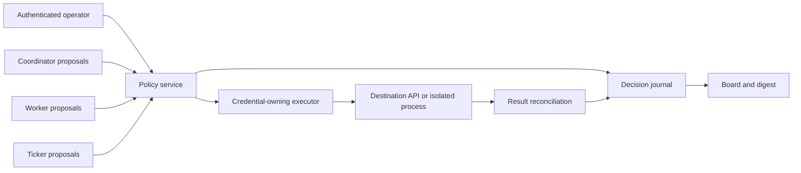

# Quartermaster autonomy dial: authority over effects

Status: independent proposal, 2026-11-08. No implementation changes.

Evidence baseline: repository commit `af0652880a73d674ef07f62cae084419667798b2`
(v0.6.0), inspected starting at `2026-11-08T17:02:30-05:00`; installed Claude
Code reports `2.1.295`. This proposal uses the task requirements, implementation,
the existing [autonomous-mode design](autonomous-mode.md), and official runtime
documentation. PR #46 and the other autonomy-dial designs were not consulted.

## Recommendation

Make the dial a cumulative **ceiling on effects the system may authorize without
TJ**. Apply the same decision to workers, the coordinator, the ticker, hooks,
and automation they start. Answering a permission prompt is a transport for that
decision, not a separate class of authority.

Use one global value, defaulting to 2 for new installations. Optional repository
and task ceilings may narrow it. A visible policy service computes the effective
value and records each consequential decision. An executor outside the agents'
permission loops owns side-effecting credentials and applies that decision.
Retain Herdr prompt answering as an integration path, not the enforcement root.

Level 9 authorizes every category of effect, including widespread production
deletion, unrecoverable data loss, disclosure of secrets, and changes to the
automation's own security configuration. Do not retain the old list of
always-critical exceptions under another name. State separately whether a
runtime and its credentials can carry out an authorized action. Authorization
cannot make an unavailable API, hard denial, or physical authentication step
disappear.

The dial grants discretion within a task or standing mission. It does not turn
every suggestion in a repository, message, or tool result into a new user goal.
At 9, a mission such as “operate these services” can authorize very broad work;
“write a design document” still does not ask the system to operate those services.

## What exists today

These are code observations, not claims about the user's current configuration.

| Surface | Current behavior | Consequence for the dial |
| --- | --- | --- |
| [`autonomy.go`](../../autonomy.go), `autonomous`, `autonomyGrant` | Config booleans, bead labels, and a local stop file authorize decide/merge/apply/install. The brief tells the worker to run a check and stop for critical operations. | This is cooperative enforcement. A successful check is not bound to a particular command, target, or subsequent execution. |
| [`dispatch.go`](../../dispatch.go), `brief`, `openCoordinator` | Briefs turn on auto-merge even outside the autonomous grant. Coordinator and workers start through `agentArgs`. | Auto-merge itself must become a gated effect. Changing only `autonomyGrant` leaves an authorization path open. |
| [`context.go`](../../context.go), `coordinatorGuide` | Coordinator waits for dispatch authorization, relays needs_me, answers only permitted prompt categories, and never independently answers a countdown denial. | Replace fixed restrictions with a common decision service; retain truthful attribution and task scope. |
| [`prompt.go`](../../prompt.go), `answerPrompt` | Reads screen text, compares an eight-hex-character hash, sends keys, waits for the prompt to disappear, then notes the answer. No autonomy classification is performed here. | Add authorization before input. Disappearance proves neither successful execution nor the intended effect. |
| [`gate.go`](../../gate.go), `checkPlan` | Parses Pulumi/Tofu plans and rejects operations outside an allowlist; every delete/replace fails. Counts can be checked with `--expect`. | Reuse parsing, but replace the universal rejection with effect classification. An `update` can change access or destroy data; counts alone do not describe its impact. |
| [`config.go`](../../config.go), `agentArgs` | Launch arguments are per agent kind, shared across coordinator/worker entry points; Muse has its own defaults. | Introduce explicit, versioned runtime profiles. Existing native modes are not dial levels. |
| [`digest.go`](../../digest.go), [`report.go`](../../report.go) | AUTO notes feed reports; digest change tracking counts notes. | Keep readable bead summaries, but use durable event IDs and timestamps for audit and delivery. |

The existing self-install exception treats a local ticker rebuild as local
work. Its effect can change every worker's policy or orchestration. Classify
installation of authority-bearing code by that reach, not its filesystem path.

## The ten levels

Each row adds authority to all preceding rows. The numbers are stable policy
names, not a measured probability of damage. They express an ordering chosen
for a coding-and-operations coordinator: local work, proposals, collaboration,
shared code, test environments, public communication, then production.

| Level | Newly authorized destination/effect | Examples and boundaries |
| --- | --- | --- |
| **0 — Observe** | Read ordinary task inputs and report to TJ. | Inspect source, PR metadata, approved operational telemetry; produce recommendations in the conversation. No autonomous source edits, dispatch, messages to other people, or remote mutations. Ordinary session bookkeeping is included; secret extraction is not an ordinary read. |
| **1 — Isolated work** | Change disposable task-owned local state. | Dispatch a worker into an isolated worktree, edit files, run contained tests, make local commits, delete generated files or a verified disposable worktree. No host configuration changes or credentialed test side effects. |
| **2 — Remote proposals** | Publish task-owned candidate artifacts to their intended review audience. | Push a task branch, open/update its draft or ready PR, update its description, upload a preview artifact to the same access boundary. No auto-merge, deployment triggers, or publishing previously private material to a public repository. |
| **3 — Shared collaboration** | Change team coordination records and communicate within the established team audience. | Post an internal update, change issue status, request review, comment on another PR, resolve a review thread with evidence. A command-bearing comment is classified by the command it triggers. |
| **4 — Shared source adoption** | Change shared source history and supply ordinary review decisions. | Merge a ready PR, enable auto-merge, update a shared development branch, approve another author's reviewed PR with attributable agent identity. Uses current-head checks and review policy. A merge/approval that releases or deploys inherits that downstream level. |
| **5 — Non-production operation** | Operate named development/staging environments and ordinary local host services. | Apply a staging plan, deploy to a test environment, recreate disposable staging data, rotate a staging credential inside its existing boundary, install an ordinary local development service. Shared credentials or copied production data raise the level. |
| **6 — External publication** | Send intended content beyond the established team boundary. | Send customer email, publish a release or public document, post externally, make a scoped purchase or subscription change. This covers deliberate publication of task content, not accidental disclosure of confidential inputs or credentials. |
| **7 — Bounded production operation** | Change a named production service within an established recovery procedure. | Canary a release, apply a scoped infrastructure update, rotate a service credential with overlapping validity, remove a redundant stateless replica. Resource identity, recovery evidence, and health criteria must be established. |
| **8 — Broad or destructive, recoverable operation** | Make larger production changes or destructive changes with evidenced recovery. | Fleet rollout with rollback, stateful replacement with verified restore, delete a bounded dataset with a tested backup, retire a cluster whose data and dependencies are accounted for. Includes rewriting/deleting shared history when recovery and consumers are accounted for. |
| **9 — Unrestricted effects** | All remaining effects; no category exclusion. | Delete production across environments without recovery, destroy sole backups or encryption keys, export secrets, publish confidential data, grant broad admin access, bypass ordinary review policy where the platform permits it, alter the authorization service, and execute actions whose impact cannot be bounded. |

Examples name the minimum level only when their stated conditions hold. A
shared branch in a second repository remains level 4; touching “someone else's
repo” is not a new level. Force-pushing a disposable task branch can be 2 if
ownership and absence of dependent consumers are established. Force-pushing a
shared release branch can be 8 or 9. Deletion is similarly contextual, from a
generated file at 1 to sole production copies at 9.

The ordering of levels 5 and 6 is a product choice: some users would permit
production automation before any customer email. Keep the initial ten labels
fixed so “level 7” has a portable meaning. If real usage repeatedly needs
non-nested permissions, add named policy profiles later rather than pretend a
single number expresses every preference.

### Effects that are easy to underestimate

**Secrets.** Using an opaque credential through a broker is part of the target
action: a level-2 push does not become level 9 because the broker authenticates
it. Reading secret material into an agent's transcript crosses a different
boundary. Raw reusable secret export/disclosure belongs at 9. Rotation within a
staging or production boundary is 5 or 7 when consumers and recovery are known;
revocation that strands consumers is 8 or 9. Audit secret references, never
values. Level 9 may authorize disclosure, but logging the secret is not needed
to carry out that disclosure.

**Approvals.** A PR approval can be the last condition for an already-enabled
auto-merge. Its required level is at least 4 and at least the level of the
reachable deployment/publication. Reviewing your own patch locally is 0;
submitting a review is a remote effect. At 4–8, an approval must satisfy the
repository's genuine identity and independence requirements. At 9, local review
requirements may be relaxed explicitly, but an automated approval must never be
represented as TJ's personal review, and server-enforced rules may still refuse.

**CI and future actions.** A branch push can run a privileged workflow. A PR
comment can apply an infrastructure plan. Enabling auto-merge authorizes a
future shared mutation, not just a metadata update. Resolve known triggers and
include their reachable effects; the executor must not accept “it only posts a
comment” as the action description. Unknown privileged triggers require 9 or
an action-specific human grant. Prefer isolated proposal CI with no deployment
credentials so level 2 remains useful.

**Coordinator answers.** “Use option B” for a local implementation choice is
level 1. “Proceed with the production apply” is 7–9. If an answer covers an
entire plan, classify all effects it authorizes; alternatively answer only the
bounded next step and re-evaluate later. Never infer that a recommendation
alone grants authority. Missing factual inputs remain missing at 9, though the
system may choose and record a reasonable assumption when the mission permits.

**Self-modification.** Editing an inert proposed hook in a worktree is 1;
activating a hook or binary that can alter authorization is 9. A repository
checkout that loads its changed hooks during the next test is not inert. The
system's own files are not privileged exceptions to effect classification.

## Classify a concrete action, not a sentence

Every consequential proposal becomes a structured request with:

- Task/mission ID, authenticated session identity, host and originating role.
- Tool, normalized operation and arguments, resolved working directory, target
  resource IDs, repository identity, branch/head or infrastructure plan digest.
- Environment and audience derived from trusted inventory, plus input data
  sensitivity and output destination.
- Direct effects, known automation triggered, maximum affected set, recovery
  evidence, expected cost, and whether future authority is being delegated.
- Evidence references, unresolved facts, classifier/schema version, and a
  unique action ID.

Originating role is for attribution, never an input that lowers the level.
Workers may suggest classifications. The service verifies target identity and
uses deterministic adapters for supported GitHub operations, deployment plans,
messages, file operations, and credential operations. An LLM may explain an
unknown action or propose a narrower one; it cannot certify its own uncertainty
away. Labels such as `prod`, `safe`, or `autonomous` supplied by an agent are
claims, not trusted inventory.

Compute `required = max(level(effect))` over the direct effect and any delegated
or automatically triggered effects. A composite shell invocation is not one
harmless command: parse supported forms and resolve scripts/artifacts, or run
inside a genuinely constrained execution environment. Changing a script after
checking its contents invalidates its authorization. Command keyword lists
cannot safely classify arbitrary programs, build scripts, shell expansion, or
indirect network calls.

Unbounded or unrecognized impact maps to 9, with an explicit “unknown effects”
reason. At levels 0–8 it requires a narrower operation or human authorization.
At 9, uncertainty about effect is not a concealed refusal category. Malformed
requests, missing arguments, unavailable targets, or conflicting execution
preconditions are operational failures; “allow all” does not supply the missing
API parameters.

Authorization and execution are separate states:

```text
proposed -> classified -> authorized -> executing -> verified
                      -> needs_authority
                                    -> runtime_blocked
                                                 -> failed / outcome_unknown
```

The authorizer checks scope and the current policy revision, then either grants
one execution or records why authority is missing. A native runtime rejection
after authorization becomes `runtime_blocked`; an uncertain API outcome becomes
`outcome_unknown`. Neither is silently retried as if nothing happened.

## One dial, with explicit scope and revocation

Proposed commands below are new interfaces, not commands available today:

```text
quartermaster autonomy set 7
quartermaster autonomy set 3 --repo example/project
quartermaster autonomy set 1 --bead task-123
quartermaster autonomy inherit --bead task-123
quartermaster autonomy explain <action-id>
quartermaster autonomy status --json
quartermaster autonomy off
```

Use an operator-owned global ceiling, optional repository ceilings, and optional
bead ceilings. Unset ceilings inherit; they are not zero. For an action touching
several targets:

```text
effective = min(global, every applicable repository ceiling, bead ceiling)
allowed = required <= effective
```

Task-only caps also constrain coordinator actions on that task. Work that is
not repository-bound uses the global and mission/task cap. Stable target
identity determines applicable repository caps; a worker cannot evade them by
changing the bead's repo label. A child task inherits the parent's restrictions
and mission; splitting a task cannot increase its authority. Coordinator
dispatch is level 1 for an isolated worker, with the child's later effects
checked separately. A generic unsandboxed launch with broad credentials is a
delegation of those capabilities and must be classified accordingly.

`autonomy status` must show the requested global value, effective values of live
tasks, every narrowing override, policy revision, native runtime/profile, and
known unsupported actions. Global 9 with a repository capped at 3 must visibly
say that the repository is still capped. Clearing those caps makes global 9 a
true system-wide category grant. No separate coordinator dial is needed.

New installations start at 2, with no implicit global mission. Selecting a task
supplies its purpose; the dial supplies how far execution may proceed without
another answer. A standing mission can authorize proactive task selection and
creation. Do not equate “high autonomy” with inventing unrelated work.

Human one-action approval may exceed the ceiling without changing it. It is
bound to the exact action, target, digest, policy revision, expiry, and permitted
attempt count. Policy changes and human approvals enter through a distinct
authenticated operator channel; `--by TJ` is a display field, not proof of
identity. A message in a bead, source file, or terminal never impersonates that
channel.

Workers at 0–8 cannot grant themselves more authority, remove ceilings, or edit
enforcement code: those are level-9 effects. Under an explicitly applicable
level-9 mission, policy and runtime configuration changes are allowed too, with
their origin recorded as automation. They cannot retroactively relabel earlier
decisions as human approvals. A new human stop supersedes prior delegation.

`off` suspends autonomous grants rather than meaning “observe at level 0.” A
separate operator stop path must remain reachable outside the coordinator. Every
new execution reads the policy revision at admission; lowering the dial revokes
unconsumed grants, queued answers, and pending delegations. Stop state and the
last committed revision survive restarts. Remote hosts cannot keep executing
mutations from a cached broad grant after losing the policy service. Loss of
that connection pauses new effects; restoration can resume automatically.

Already accepted external effects cannot always be stopped. Record pending
auto-merges and workflow jobs, attempt supported cancellation, and report what
is still running. At levels 0–8, do not create future authority that outlives its
revocation mechanism: use a merge executor that rechecks authority immediately
before merging instead of an unattended GitHub auto-merge request with no such
check. Level 9 can accept an irrevocable delegation explicitly. Stopping a
database migration midway may be worse than finishing it; each adapter needs
safe cancellation and reconciliation semantics, not indiscriminate process kills.

## Enforce outside the decision-making models

The coordinator is exposed to the same untrusted task text as workers. It is
not a security boundary merely because it is a second agent. Prompt text,
standing instructions, and a worker voluntarily running `autonomy check` are
useful explanations; none prevents another tool from performing the effect.



Start with a separate local service process and typed adapters; there is no need
for a new distributed database or another planning LLM. Authenticate callers by
launcher-issued session credentials, not a self-reported bead ID. The launcher
binds the session to the task, host, repo identity and delegated scope. A worker
has proposal access but no operator credentials or other session's identity.

For enforceable limits, run agents and their local builds in separate constrained
process identities/containers. Keep destination credentials, policy storage,
audit storage, the host's raw Herdr socket, and the executor's code outside their
write/read capabilities as appropriate. Expose only the scoped broker API.
Worktree separation alone is insufficient: linked worktrees share Git metadata,
and same-UID processes can often edit each other's files or access credentials.

The executor owns sensitive writes, Git transport, messaging, deployment and
credential APIs. It rechecks authorization and preconditions immediately before
the effect. Bind permits to exact payload hashes and destination identities;
reject replay, a changed PR head, a different infrastructure plan, expired
credentials, or policy revision changes. Use service-side conditional writes
where available. A deployment preview without a stable executable plan needs
fresh target validation at apply; do not claim its JSON digest freezes the world.

This boundary must cover all egress paths: shell programs, browser sessions,
MCP connectors, direct API clients, background jobs and spawned agents. If an
agent retains a direct write-capable connector, the dial cannot enforce that
connector's effects. Report the installation as **advisory**, rather than
claiming enforcement from hooks alone. Broker-local operations are subject to
the same policy even when they originate from the ticker.

### Claude Code: gates are not interchangeable

The installed CLI is `2.1.295`; its help lists `manual`, `acceptEdits`, `auto`,
`plan`, `dontAsk`, and `bypassPermissions`. Official live documentation uses
`default` in some tables. Select actual accepted arguments from the installed
version, and test the adapter after upgrades. The following are documentation
findings, not results of live permission experiments.

| Gate or runtime behavior | Integration consequence |
| --- | --- |
| Native approval dialog or hook `ask` with an actionable choice | Answer only after the underlying action has a valid authorization; select a one-use approval. |
| Auto-mode countdown dialog | A countdown alone does not prove a classifier verdict. Critical-path removal prompts have this UI too. Classify the real action and correlate runtime metadata before answering. |
| Classifier denial without a dialog | There is nothing for Herdr to answer. Record the denial and its origin; do not send speculative keys or fabricate a user reply. |
| Explicit deny, blocking hook, sandbox or managed restriction | A quartermaster grant does not remove it. Surface a runtime blocker; changes require the legitimate owner/configuration path. |
| Missing login, passkey, credential or API privilege | Report an operational dependency. No dial value manufactures identity or access. |

Claude's documented hook interface offers `allow`, `ask`, and `deny` decisions.
An `ask` normally produces a prompt, but protected-path or unsandboxed requests
can be denied before one appears. `PermissionDenied` can request a retry; it
does not reverse the denial. These facts rule out a universal “answer yes”
implementation. [Hooks reference](https://code.claude.com/docs/en/hooks)

PreToolUse approvals do not generally override matching deny/ask rules. Managed
settings and plugin/mod precedence also affect results. Pin and inspect the
effective configuration rather than assuming a repository hook has final
authority. [Permission precedence](https://code.claude.com/docs/en/permissions#precedence-among-rules-hooks-and-mods)

`bypassPermissions` is not an unrestricted capability guarantee: documented
critical-path removals can still prompt or deny, and administrators can disable
the mode. Current docs include behavior introduced after 2.1.295; in particular,
the critical-removal bypass setting requires 2.1.311 and is not a solution for
this installed version. [Permission modes](https://code.claude.com/docs/en/permission-modes)

The 2.1.295 release adds `onFailure: "block"` for command/HTTP hooks. That is a
useful prerequisite for a policy hook: startup failures and timeouts must not
silently permit execution. It does not replace containment or destination-side
authorization. [Versioned changelog entry](https://github.com/anthropics/claude-code/blob/main/CHANGELOG.md#21295)

Use a fail-closed policy hook at every supported tool boundary, including the
coordinator's own tools. Prefer a broker-backed native approval callback/hook
over screen parsing. Keep the coordinator's runtime able to submit ordinary
typed proposals to the broker; it should not itself need permission to invoke
each raw production command. A coordinator blocked inside Claude cannot answer
its own runtime gate through more reasoning.

Do not map 0–9 to six native mode names. Recommended launch strategy:

- For 0, expose only observation tools and narrowly scoped read capabilities.
- For 1–8, use the installed normal/manual permission mode with policy hooks,
  contained local execution, and brokered remote effects. `acceptEdits` can
  reduce local prompts only inside that confinement. `auto` is optional extra
  screening, with explicitly visible runtime refusals; it cannot define levels.
- For 9, the same broker can authorize all effects. A native bypass profile is
  optional where the operator permits it and the runtime supports it, not the
  definition of 9 and not a way to override managed policy. Its launch warning
  and remaining gates must be resolved honestly during setup.

Provision these paths before unattended operation. A hard runtime refusal is
not permission to relaunch a different model or re-encode the denied command
until it passes. An operator can configure an independent executor as the
normal authority path; do not install or switch to it ad hoc to evade a denial.
Codex and Muse need their own tested adapters and capability reports. Their
flags must not be inferred from Claude's names or treated as equivalent because
they reduce prompts.

### Herdr answer integrity

Keep `quartermaster answer --expect` for already-supported terminal prompts,
but require an action authorization and authenticated provenance. The current
hash is a freshness convenience, not a security token: it truncates SHA-256,
normalizes whitespace, and represents only parsed screen content. Whitespace
inside quoted commands can matter. Reading and then sending keys also leaves a
race if another actor changes the prompt between those operations.

Prefer an atomic Herdr operation keyed to session generation and prompt/event
ID, backed by structured tool input. Until that exists, screen answers are an
advisory fallback: serialize delivery, reread immediately, refuse incomplete
commands, and clearly disclose the residual race. A prompt's disappearance is
followed by result reconciliation. It must not create a successful action audit
entry by itself. Standing-permission choices authorize future effects and must
be classified as such, rather than accepted in place of one-use approval.

## Information, audit, and failure behavior

High autonomy should reduce interruptions while increasing visibility. On every
dial change, show what categories became newly available and which tasks remain
capped. The board should display `effective 7 / required 8: needs authority`, or
`authorized 9 / runtime blocked`, rather than collapsing both into “needs you.”

Persist a decision event before a consequential attempt and a separate outcome
event afterward. Record UTC time, action ID, task, session/actor, policy revision,
required/effective levels, target and payload digests, evidence, authorization
source, native gate result, API request/run IDs, outcome and verification. Store
secret references and redacted summaries. Beads holds readable milestone notes;
the journal is the execution record. The event sequence must distinguish denied,
approved-but-unattempted, attempted, completed, and unknown-outcome actions.

At levels 7–9, emit immediate nonblocking notifications for production changes,
disclosures, policy changes and destructive effects, followed by verification.
Do not add a hidden waiting period for TJ to veto every level-9 action. The
hourly digest groups actions by destination and task, highlights failures and
unknown outcomes, and links evidence. Delivery cursors use event IDs, retries
are deduplicated, and notification failure never turns into claimed delivery.

Keep the journal outside agent-writable state and optionally replicate it.
Durable recording is a normal executor precondition; an unavailable journal
pauses admission until recovery instead of silently losing evidence. Level 9
can explicitly authorize operation without audit or destruction of the journal
itself. That sacrifices the audit guarantee and should leave an external event
if possible. “Nothing excluded at 9” and “tamper-proof against a level-9 actor”
cannot both be absolute promises.

| Failure | Required behavior |
| --- | --- |
| A model calls production “staging,” or omits a triggered deploy | Resolve environment from credentials/resource inventory and known trigger graph. Unknown effects require 9; never lower a level because of confident prose. |
| Prompt injection in a PR, bead, log, web page or worker response | Treat it as untrusted data. It cannot change operator policy, mission provenance, or approval identity. Constrain targets and credentials independently of the coordinator's reasoning. |
| Agent edits labels, hooks, its launch args, or creates a child to escape a cap | Labels are display hints; launcher identity and protected policy remain authoritative. At 0–8 deny authority expansion. At 9 record deliberate policy changes as level-9 effects. |
| Stale approval or policy reduction while an action queues | Reject unconsumed permits at the executor; reclassify against the new head/plan/revision. Track and cancel pending external delegations where possible. |
| Crash after the destination accepted a write | Reconcile by idempotency key, request ID, or resource state before retry. A human or agent decision cannot make an unknown outcome safe to repeat. |
| Two workers mutate the same target | Serialize by resource/branch key and use target version preconditions. Task ownership alone is not a lock on shared resources. |
| Hook/service failure or a partitioned remote worker | Pause new mediated effects; keep read-only observation available where possible. Resume after health and policy revision are re-established. |
| Repeated denial, planner churn, or retry loop | Stop repeating the same action without new evidence; back off and mark the cause. Never escalate runtime modes automatically because a tool refused. |
| Runaway fan-out or spending | Use per-mission concurrency, retry and cost budgets with a central reservation counter. Pause only the affected mission when exhausted; report exact consumption. |

Budgets are explicit operating constraints, not secret vetoes attached to a
level. An operator may choose finite limits at 9, in which case the UI says
“all effect categories, budget limited.” An unrestricted level-9 mission can
remove those limits; non-progress detection can still stop useless repetition
without requiring TJ to authorize each valid next action. This cannot guarantee
zero interruptions if useful progress actually becomes impossible.

At 9, prompt injection is still a serious residual risk: a hijacked planner may
propose a harmful action that its broad mission really authorizes. No
classifier can reliably convert unrestricted authority into least privilege.
The dial must communicate that tradeoff instead of promising both.

## Implementation order and acceptance evidence

This is a substantial change in authority, not a relabeling of the existing
booleans. Ship it in increments that do not overstate their enforcement.

1. **Policy model and explanation, initially shadow-only.** Add the level table,
   effect request schema, target registry, cap inheritance, policy revisions,
   and `explain`. Generate worker/coordinator guidance from that same model.
   Compare classifications on existing workflows without authorizing new effects.
2. **Typed effect adapters and journal.** Cover branch/PR writes, approval/merge,
   internal/external messages, deployment plans and secrets. Turn `gate.go` into
   evidence extraction plus classification. Record decisions and outcomes, and
   expose missing adapter coverage.
3. **Containment and runtime integration.** Isolate sessions and credentials;
   add Claude hooks and launcher profiles, broker execution, remote-host policy
   checks, and tested Codex/Muse adapters. Cover the coordinator and ticker too.
   Only mark a path enforced when direct alternative routes are closed.
4. **Board, migration, and unattended operation.** Show effective levels,
   runtime blockers, event summaries, cancellation results, and a reachable stop
   control. Remove contradictory fixed rules and unconditional auto-merge from
   briefs when the new policy becomes authoritative.

Do not automatically translate the old `autonomous` label to 7 or 9. Its old
permission set is not one of these cumulative prefixes: for example, it can
permit a production apply while excluding external messages and all deletions.
Keep existing tasks on the legacy policy until TJ selects their new level; show
the permissions added and removed. A preview-only migration command can suggest
the closest conservative ceiling. Never silently broaden authority on upgrade.

Acceptance must demonstrate behavior, not compare generated prompt strings:

- Table-driven classifications assert structured required levels, effects and
  reasons. Include all ten levels; own/other repositories and coordinator/worker
  origins must produce the same result for identical effects.
- Property tests prove monotonic grants, minimum-cap composition, cross-repo
  caps, child inheritance, and denial of self-escalation below 9. Include unknown
  effect requests allowed at 9 to catch accidental permanent exclusions.
- Fake GitHub/deployment/message services prove that approval, auto-merge and
  trigger comments inherit their downstream effects; changed heads/plans and
  stale policy revisions cannot consume an old authorization.
- Test deleting a generated file at 1, disposable staging data at 5, recoverable
  production data at 8, and unrecoverable fleet data at 9. Use fake destinations,
  not real destructive operations. Cover raw secret export at 9 and opaque
  credential use at the underlying operation's level.
- Isolated runtime contract tests exercise hook allow/ask/deny, hook timeout,
  prompted countdown, no-prompt denial, coordinator self-block, standing-choice
  refusal, and startup/resume mode differences for each supported version.
  Assert structured events and side effects; screen parsing tests alone are not
  proof of authorization correctness.
- Fault tests cover admission/journal crash windows, unknown API outcomes,
  duplicate delivery, concurrent workers, stop during a queued action, remote
  partition, deferred merge cancellation, and notification outage. A lowered
  dial must prevent the next new effect without waiting for an idle worker.
- A containment test deliberately attempts the same prohibited write through
  shell, MCP, browser, raw Herdr access and a child process. An exposed alternate
  path means the installation is advisory, regardless of hook test results.

For this document, code paths were inspected and official documentation was
cross-checked with the installed CLI version and upstream changelog. Focused
existing autonomy, prompt-answering and plan-gate tests passed. Local document
links, the ten level entries and whitespace were checked. No live
approval, deployment, secret, or destructive-operation experiments were run.
The proposed broker, containment and runtime contracts remain to be implemented
and tested; this design does not claim they already exist.

## Three disagreements with the framing

1. **A ten-step scalar is a chosen permission ordering, not a universal risk
   scale.** External communication, money, production availability and secret
   exposure are not naturally comparable. Keep the simple dial, but name the
   effects precisely and admit that its ordering is a product preference.
2. **Destination is necessary but insufficient.** A harmless-looking internal
   comment can deploy to production; a local hook edit can grant global access;
   a secret read changes who possesses a capability. Classify the full reachable
   effect and delegation, not only the immediate output location.
3. **Allow-all and guaranteed hands-off completion are different promises.**
   Support genuine category-level allow-all at 9, including unrecoverable
   production deletion. Do not pretend it overrides hard runtime denials,
   external authorization, missing facts or broken services. A system can grant
   the requested authority while honestly reporting that execution is blocked.

Review decision: adopt this level ordering and broker-based enforcement model,
or revise the ordering/scope before implementation. In particular, decide
whether the first implementation may ship as explicitly advisory while the
credential and runtime boundaries are built.
